<p align="center">
  <picture>
    <source media="(prefers-color-scheme: dark)" srcset=".github/assets/banner-dark.svg">
    <source media="(prefers-color-scheme: light)" srcset=".github/assets/banner-light.svg">
    
  </picture>
</p>

<p align="center">
  <a href="https://www.spaceappschallenge.org/2026/find-a-team/quantum-fit/"></a>
  <a href="https://www.spaceappschallenge.org/2026/find-a-team/quantum-fit/"></a>
  <a href="https://quantumfit.org/home.html?lang=en"></a>
  
  <a href="LICENSE"></a>
</p>

<p align="center"><b>English</b> · <a href="README.tr.md">Türkçe</a></p>

> **Pluto was found by blinking two photographs.** RedBeast puts that same tool in anyone's browser,
> pointed at NASA's SPHEREx survey of the whole sky.

## The challenge

SPHEREx maps the entire sky every six months in 102 colours of near-infrared light. Stars, brown
dwarfs, asteroids and maybe an unknown planet give themselves away by moving or changing between
those maps, but only if someone compares them. The **Planet X and SPHEREx** challenge asks for a public
web tool that makes that comparison easy for anyone.

RedBeast is our answer: open the page, pick a star, press **Blink**.

<p align="center">
  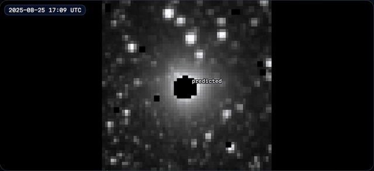
  <br><sub>Real frames from the NASA/IPAC IRSA archive, switched with a hard cut. Nothing is interpolated.</sub>
</p>

## What you can do

| | |
|:--|:--|
| 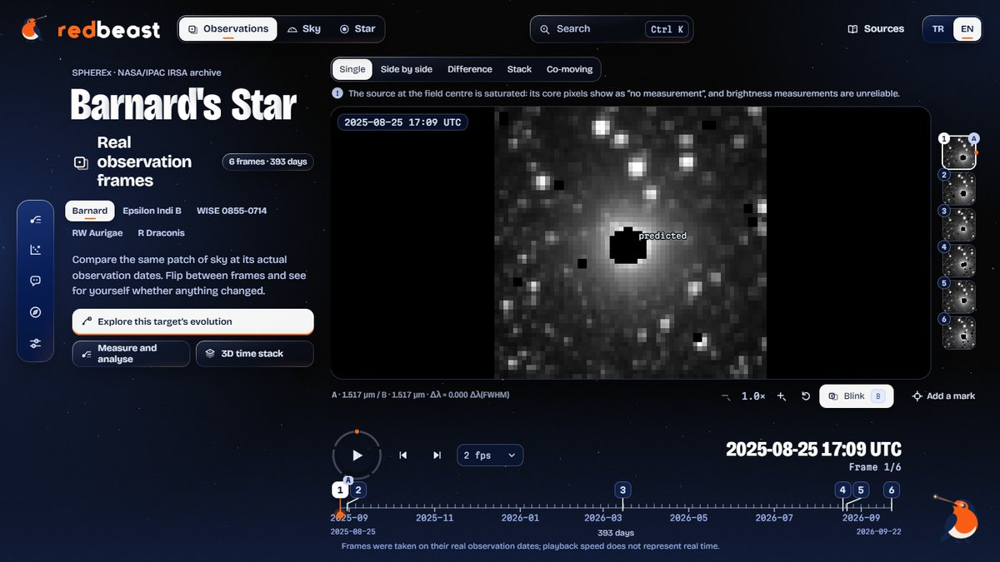 | **Compare real frames over time.** Five prepared targets or any sky position. Blink, side by side, difference, stack and co-moving views, every frame at its real observation date with its wavelength, quality flags and archive provenance. |
| 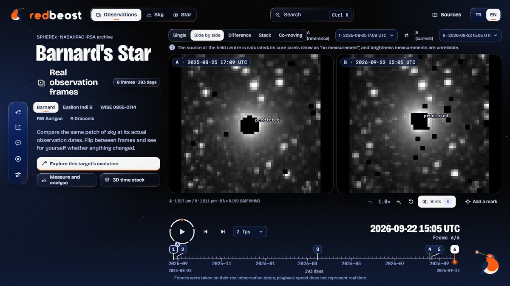 | **See what moved.** Frame A against frame B, the catalogue's predicted position marked, the wavelength gap between the two frames stated in band widths so a colour difference is not mistaken for change. |
| 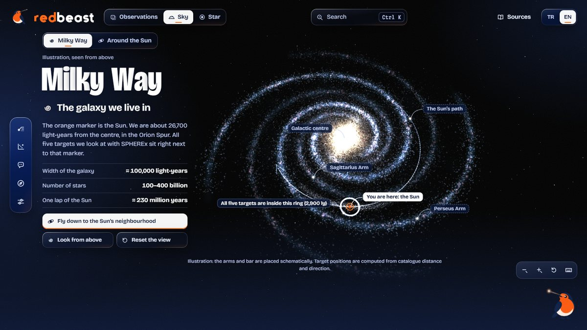 | **Find where it is.** An illustrated Milky Way seen from above, with the Sun and the five targets placed from catalogue distances, then a flight down to the 120 measured stars around the Sun (ESA Gaia DR3). |
| 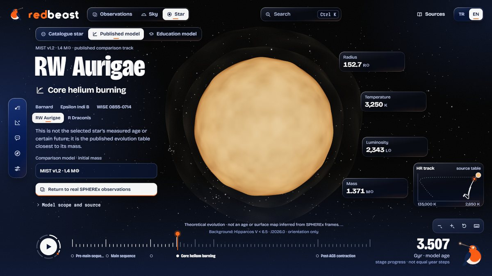 | **Follow its life.** Published evolution tracks (MIST, BHAC15, ATMO) for each target, and an education model that runs a star from birth to white dwarf, neutron star or a lensed black hole. |
| 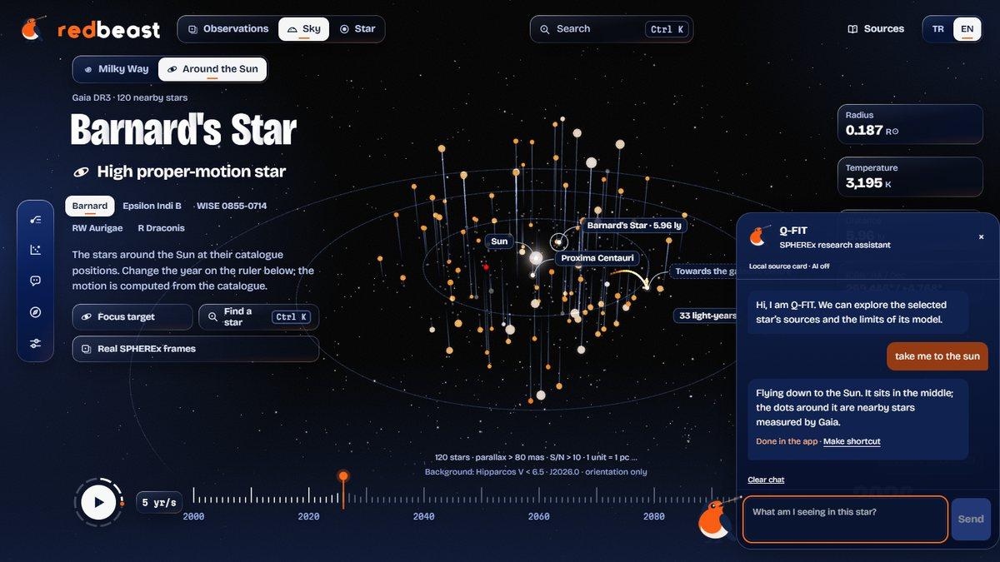 | **Ask the robin.** Q-FIT, the assistant behind our robin, carries out plain requests such as *take me to the Sun* or *compare side by side*, and answers science questions with the sources attached. |

## Inside RedBeast

### Q-FIT evidence walkthrough

Ask *Show me the evidence for Barnard’s Star*. Q-FIT opens the first and last SPHEREx frames side by side, overlays the predicted position, and brings up the measurement report.

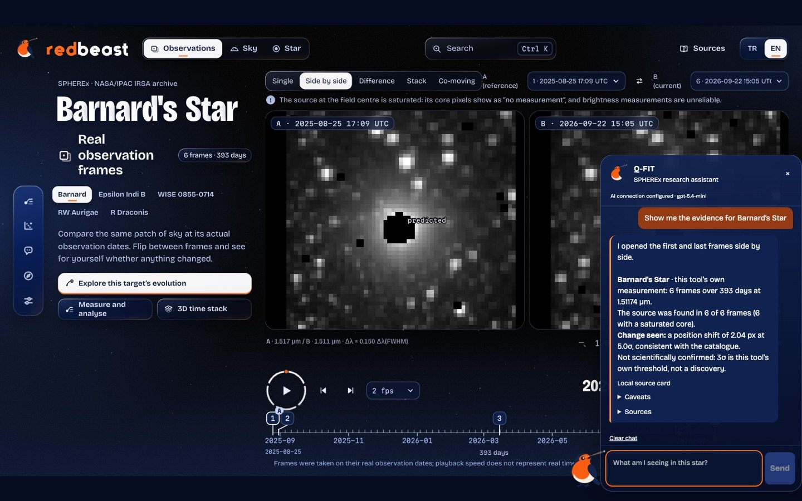

| 3D time stack | Coordinate search |
|:--|:--|
| 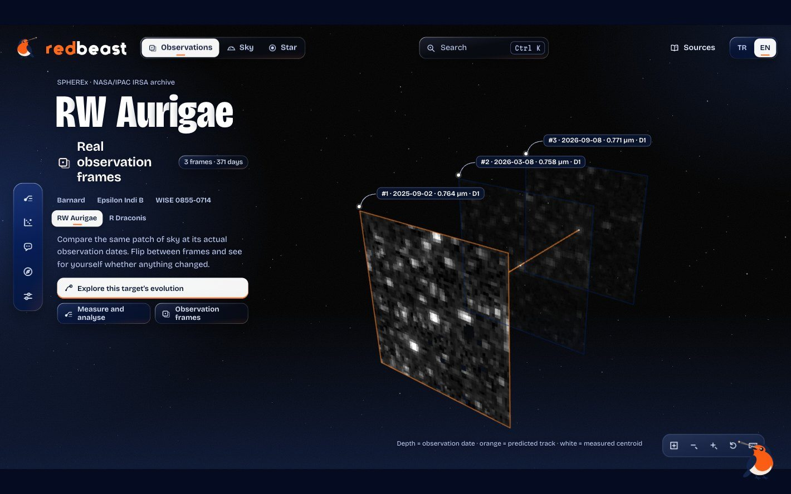 | 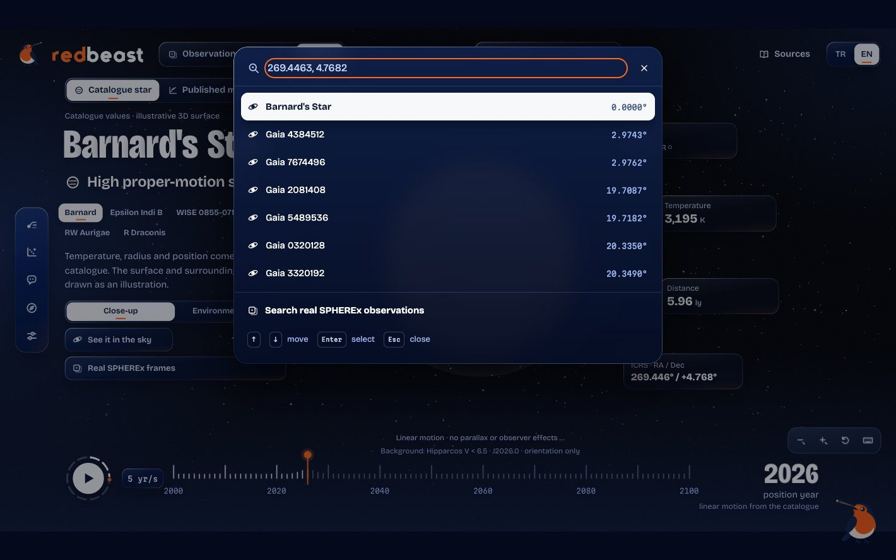 |
| See how the actual frames line up across observation dates. | Enter right ascension and declination to find nearby catalogue objects. |
| **Solar neighbourhood** | **Educational black-hole model** |
| 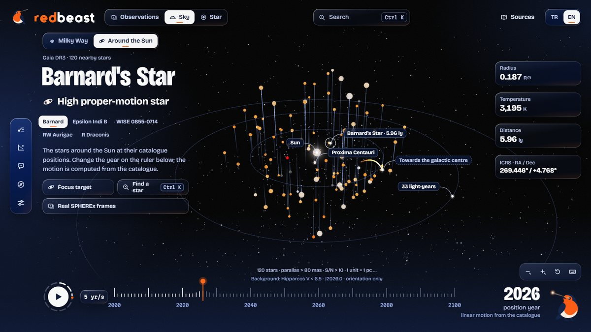 | 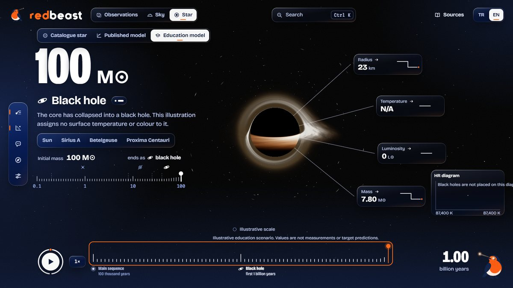 |
| Explore nearby stars from Gaia’s catalogue. | Change the starting mass to explore one possible outcome in the illustrative simulation. |

## What we measured

Run on real SPHEREx Level-2 frames with RedBeast's own pipeline. "Change seen" means at least 3σ in
our measurement. Nothing here is a discovery, and nothing is marked as scientifically confirmed.

| Target | Frames · days | What we measured | Significance |
|:--|:--|:--|:--|
| Barnard's Star | 6 · 393 | moved 2.04 px | 5.0σ, agrees with Gaia |
| Epsilon Indi B | 6 · 525 | moved 1.15 px | 7.0σ, agrees with Gaia |
| RW Aurigae | 3 · 371 | brightness changed 2.6× | 5.6σ |
| WISE 0855−0714 | 2 · 368 | not detected in these frames | reported as such |
| R Draconis | 8 · 468 | saturated core | no claim |

Full reports: [`RedBeast/reports/targets`](RedBeast/reports/targets/README.md).

## How it works

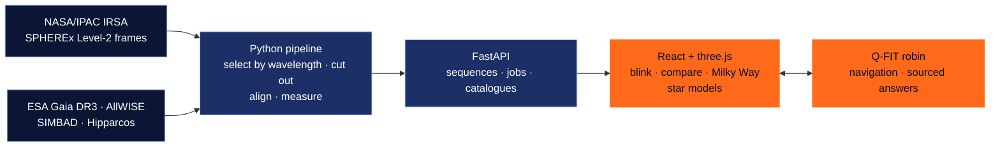

- **Archive first.** Frames come straight from the IRSA SPHEREx archive. Frames are grouped by the
  wavelength at the target's position, because SPHEREx wavelength changes across each detector.
- **Honest by design.** Measured, computed and illustrative values are labelled apart. Real frames
  switch with hard cuts. Invalid pixels stay missing. The Milky Way, star surfaces and the black hole
  are drawings and say so.
- **Works when the archive is busy.** The five prepared targets run offline. Live searches wait out
  archive errors for at most a minute, can be cancelled at any time and say why they are waiting.

## Run it

**Docker** (simplest):

```bash
cd RedBeast
docker compose up --build
```

Then open <http://localhost:8000>.

**Without Docker** (Python 3.12+, Node 22):

```bash
cd RedBeast
python -m venv .venv
.venv/bin/pip install -c backend/requirements.lock -r backend/requirements.txt
npm --prefix frontend ci
npm --prefix frontend run build
PYTHONPATH=backend .venv/bin/python -m tools.launch
```

Then open <http://127.0.0.1:8765>. On Windows use `.venv\Scripts\` instead of `.venv/bin/`. On macOS,
`RedBeast/Start-BlinkSpace.command` does all of this. Details: [`RedBeast/README.md`](RedBeast/README.md),
[API](RedBeast/docs/API.md), [deployment](RedBeast/docs/DEPLOY.md).

## Repository

| Path | Contents |
|:--|:--|
| `RedBeast/backend` | FastAPI server, archive client, SPHEREx pipeline, photometry, Q-FIT adapter, tests |
| `RedBeast/frontend` | React and three.js interface, design system, tests, built app in `dist/` |
| `RedBeast/seed-data` | Five prepared targets: 25 real SPHEREx cutouts and their processed frames |
| `RedBeast/reports` | Per-target measurement reports and validation output |
| `RedBeast/docs` | Method, data sources, API, design system, user guide |

## Team

**Quantum Fit**, Bursa, Türkiye · [quantumfit.org](https://quantumfit.org/home.html?lang=en) ·
[Space Apps team page](https://www.spaceappschallenge.org/2026/find-a-team/quantum-fit/)

## Credits and disclosure

- SPHEREx data: NASA/JPL-Caltech, served by the NASA/IPAC Infrared Science Archive (IRSA), which is
  funded by NASA and operated by the California Institute of Technology. Catalogues: ESA Gaia DR3,
  AllWISE, SIMBAD (CDS), Hipparcos. Evolution tracks: MIST v1.2, BHAC15, ATMO 2020.
  Full list: [`RedBeast/docs/DATA_SOURCES.md`](RedBeast/docs/DATA_SOURCES.md).
- RedBeast is an independent team project. It is not developed or endorsed by NASA.
- AI tools assisted with code, interface and documentation; see
  [`RedBeast/docs/AI_USAGE.md`](RedBeast/docs/AI_USAGE.md). The robin artwork comes from the team's own Q-FIT project.
- Code licence: [MIT](LICENSE). Fonts: Bricolage Grotesque and Martian Mono (SIL Open Font Licence).
