<p align="center">
  <picture>
    <source media="(prefers-color-scheme: dark)" srcset=".github/assets/banner-dark.svg">
    <source media="(prefers-color-scheme: light)" srcset=".github/assets/banner-light.svg">
    
  </picture>
</p>

<p align="center">
  <a href="https://www.spaceappschallenge.org/2026/find-a-team/quantum-fit/"></a>
  <a href="https://www.spaceappschallenge.org/2026/find-a-team/quantum-fit/"></a>
  <a href="https://quantumfit.org/home.html?lang=en"></a>
  
  <a href="LICENSE"></a>
</p>

<p align="center"><a href="README.md">English</a> · <b>Türkçe</b></p>

> **Plüton iki fotoğraf art arda gösterilerek bulundu.** RedBeast aynı aracı herkesin tarayıcısına
> getiriyor ve NASA'nın SPHEREx gökyüzü taramasına çeviriyor.

## Görev

SPHEREx bütün gökyüzünü altı ayda bir, yakın kızılötesinin 102 renginde haritalıyor. Yıldızlar,
kahverengi cüceler, asteroitler ve belki de bilinmeyen bir gezegen, bu haritalar arasında yer
değiştirerek ya da parlaklığı değişerek kendini belli ediyor; ama yalnızca biri onları karşılaştırırsa.
**Planet X and SPHEREx** görevi, bu karşılaştırmayı herkes için kolaylaştıran açık bir web aracı istiyor.

RedBeast bizim cevabımız: sayfayı aç, bir yıldız seç, **Blink**'e bas.

<p align="center">
  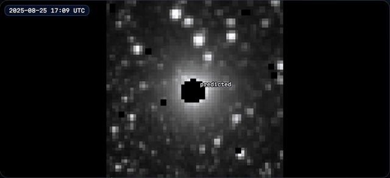
  <br><sub>NASA/IPAC IRSA arşivinden gerçek kareler, sert kesmeyle değişiyor. Araya hiçbir şey eklenmiyor.</sub>
</p>

## Neler yapabilirsin

| | |
|:--|:--|
| 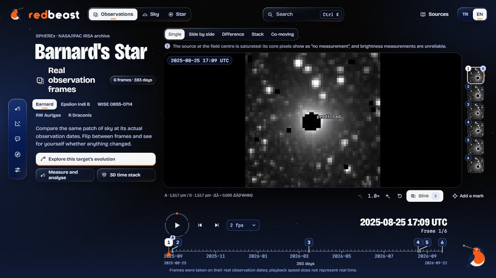 | **Gerçek kareleri zaman içinde karşılaştır.** Hazır beş hedef ya da gökyüzünde herhangi bir konum. Blink, yan yana, fark, yığın ve hedefle birlikte görünümleri; her kare gerçek gözlem tarihinde, dalga boyu, kalite işaretleri ve arşiv kaydıyla. |
| 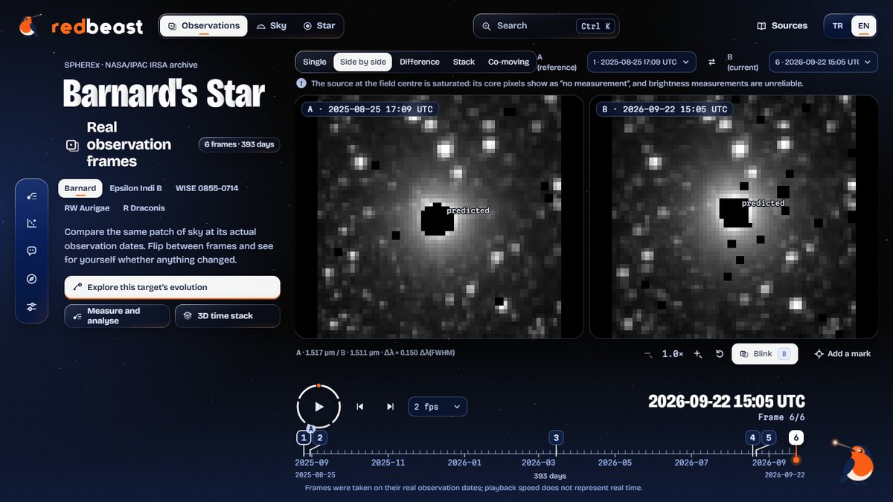 | **Neyin kaydığını gör.** A karesine karşı B karesi, kataloğun öngördüğü konum işaretli; iki kare arasındaki dalga boyu farkı bant genişliği cinsinden yazılı, böylece renk farkı değişim sanılmıyor. |
| 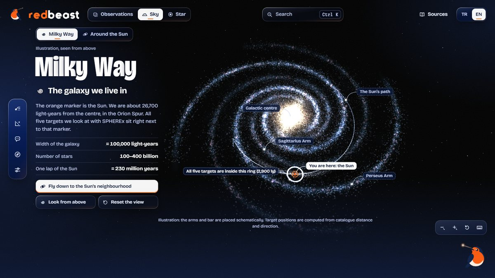 | **Nerede olduğunu bul.** Üstten çizilmiş bir Samanyolu; Güneş ve beş hedef katalog uzaklıklarıyla yerinde. Sonra Güneş'in çevresindeki 120 ölçülmüş yıldıza iniş (ESA Gaia DR3). |
| 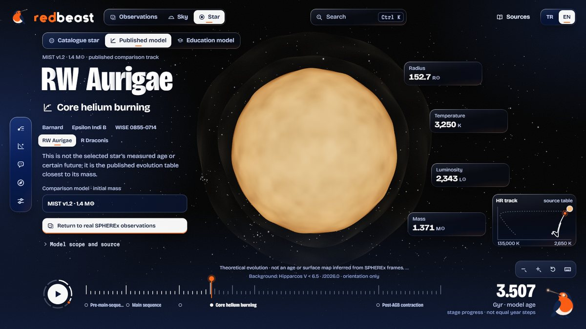 | **Yaşamını izle.** Her hedef için yayımlanmış evrim tabloları (MIST, BHAC15, ATMO) ve bir yıldızı doğumdan beyaz cüceye, nötron yıldızına ya da ışığı büken bir kara deliğe götüren eğitim modeli. |
| 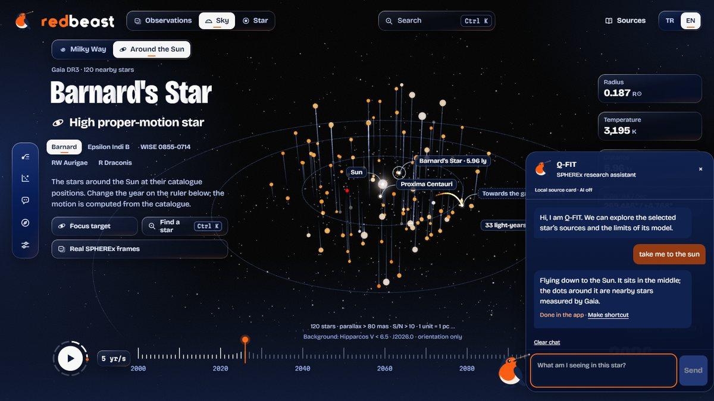 | **Kuşa sor.** Kuşumuzun arkasındaki asistan Q-FIT, *Güneş'e götür* ya da *yan yana karşılaştır* gibi istekleri uygulamada kendisi yapar; bilim sorularına kaynağıyla cevap verir. |

## RedBeast’in içinden

### Q-FIT ile ölçüm kanıtını incele

*Barnard’ın kanıtını göster* yaz. Q-FIT ilk ve son SPHEREx karelerini yan yana açar, tahmini konumu işaretler ve ölçüm raporunu gösterir.

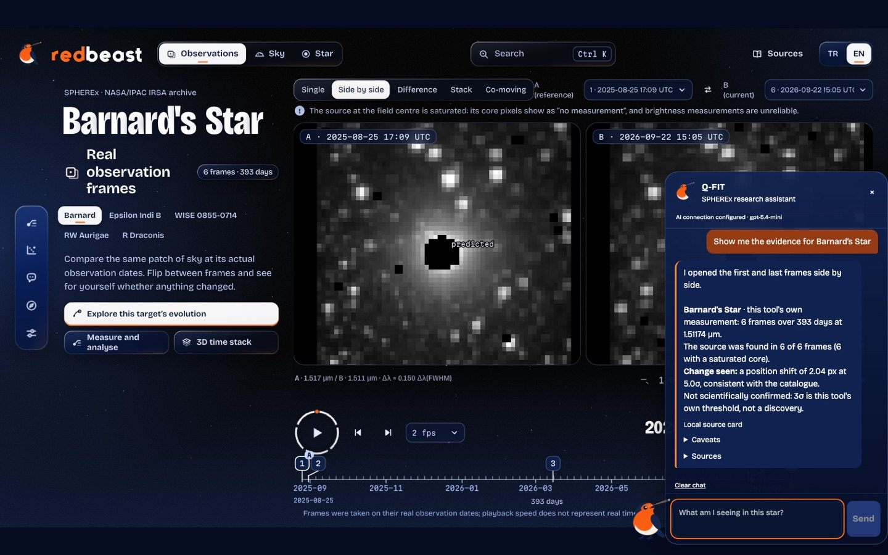

| 3B zaman yığını | Koordinat araması |
|:--|:--|
| 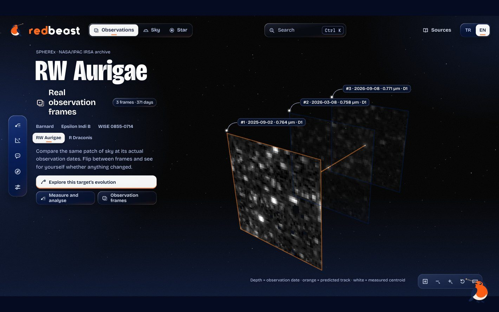 | 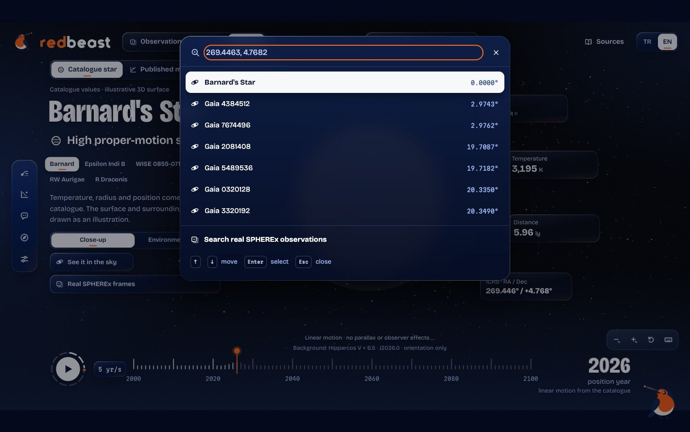 |
| Gerçek karelerin farklı gözlem tarihlerinde nasıl hizalandığını gör. | Sağ açıklık ve dik açıklık girerek yakın katalog cisimlerini bul. |
| **Güneş’in çevresi** | **Kara delik eğitim modeli** |
| 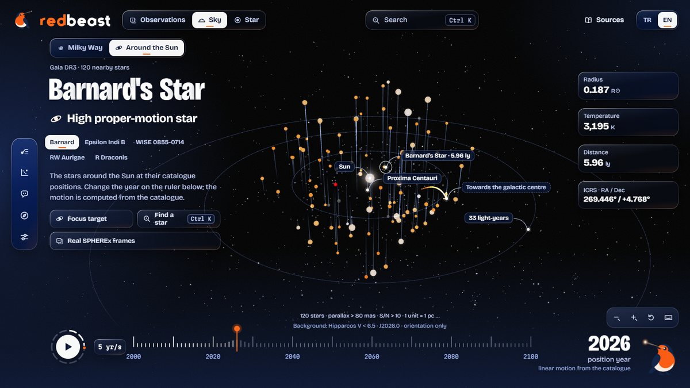 | 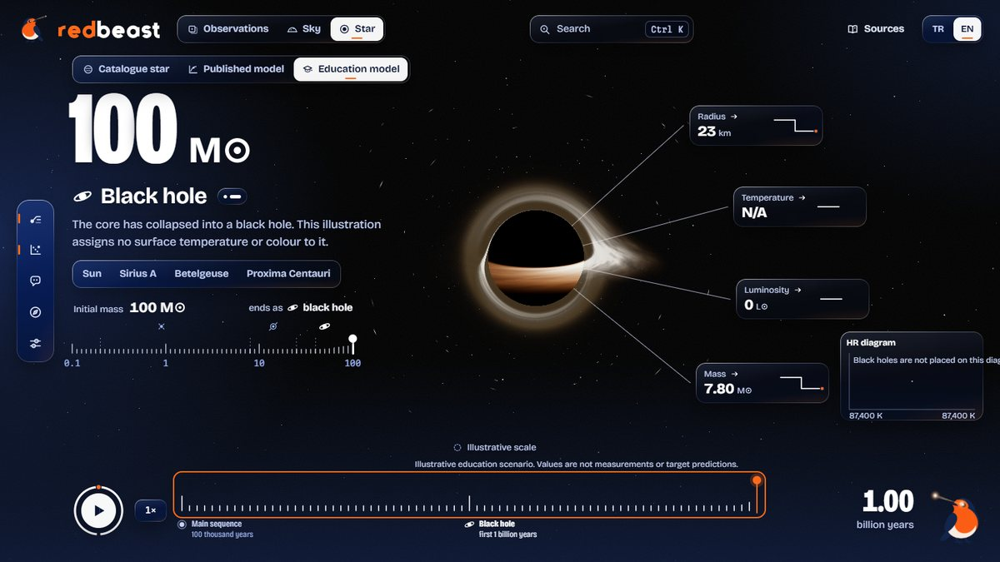 |
| Gaia kataloğundan Güneş’e yakın yıldızları incele. | Başlangıç kütlesini değiştirerek temsili modeldeki olası sonlardan birini gör. |

## Ne ölçtük

Gerçek SPHEREx Level-2 kareleri üzerinde, RedBeast'in kendi hattıyla. "Değişim görülüyor", kendi
ölçümümüzde en az 3σ demek. Buradaki hiçbir şey keşif değil; hiçbiri bilimsel olarak doğrulanmış diye
işaretlenmiyor.

| Hedef | Kare · gün | Ölçtüğümüz | Anlamlılık |
|:--|:--|:--|:--|
| Barnard Yıldızı | 6 · 393 | 2,04 piksel kaydı | 5,0σ, Gaia ile uyumlu |
| Epsilon Indi B | 6 · 525 | 1,15 piksel kaydı | 7,0σ, Gaia ile uyumlu |
| RW Aurigae | 3 · 371 | parlaklık 2,6 kat değişti | 5,6σ |
| WISE 0855−0714 | 2 · 368 | bu karelerde seçilemedi | olduğu gibi raporlandı |
| R Draconis | 8 · 468 | çekirdek doymuş | iddia yok |

Raporların tamamı: [`RedBeast/reports/targets`](RedBeast/reports/targets/README.md).

## Nasıl çalışıyor

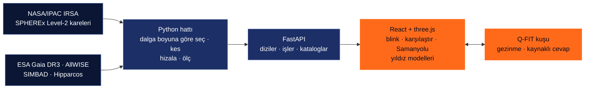

- **Önce arşiv.** Kareler doğrudan IRSA SPHEREx arşivinden gelir. SPHEREx'te dalga boyu dedektör
  boyunca değiştiği için kareler, hedefin konumundaki dalga boyuna göre gruplanır.
- **Baştan dürüst.** Ölçülen, hesaplanan ve temsili değerler ayrı etiketlidir. Gerçek kareler sert
  kesmeyle değişir. Geçersiz pikseller boş kalır. Samanyolu, yıldız yüzeyleri ve kara delik çizimdir
  ve bunu söyler.
- **Arşiv yoğunken de çalışır.** Hazır beş hedef çevrimdışı çalışır. Canlı aramalar arşiv hatalarını
  en fazla bir dakika bekler, istendiği an iptal edilir ve neden beklediğini söyler.

## Çalıştır

**Docker** (en kolayı):

```bash
cd RedBeast
docker compose up --build
```

Sonra <http://localhost:8000> adresini aç.

**Docker olmadan** (Python 3.12+, Node 22):

```bash
cd RedBeast
python -m venv .venv
.venv/bin/pip install -c backend/requirements.lock -r backend/requirements.txt
npm --prefix frontend ci
npm --prefix frontend run build
PYTHONPATH=backend .venv/bin/python -m tools.launch
```

Sonra <http://127.0.0.1:8765> adresini aç. Windows'ta `.venv/bin/` yerine `.venv\Scripts\` kullan.
macOS'ta `RedBeast/Start-BlinkSpace.command` bunların hepsini yapar. Ayrıntılar:
[`RedBeast/README.tr.md`](RedBeast/README.tr.md), [API](RedBeast/docs/API.md),
[kurulum](RedBeast/docs/DEPLOY.md).

## Depo

| Yol | İçerik |
|:--|:--|
| `RedBeast/backend` | FastAPI sunucusu, arşiv istemcisi, SPHEREx hattı, fotometri, Q-FIT bağlantısı, testler |
| `RedBeast/frontend` | React ve three.js arayüzü, tasarım sistemi, testler, `dist/` içinde derlenmiş uygulama |
| `RedBeast/seed-data` | Hazır beş hedef: 25 gerçek SPHEREx kesiti ve işlenmiş kareleri |
| `RedBeast/reports` | Hedef başına ölçüm raporları ve doğrulama çıktıları |
| `RedBeast/docs` | Yöntem, veri kaynakları, API, tasarım sistemi, kullanım kılavuzu |

## Takım

**Quantum Fit**, Bursa, Türkiye · [quantumfit.org](https://quantumfit.org/home.html?lang=en) ·
[Space Apps takım sayfası](https://www.spaceappschallenge.org/2026/find-a-team/quantum-fit/)

## Kaynaklar ve beyan

- SPHEREx verisi: NASA/JPL-Caltech; NASA tarafından finanse edilen ve California Institute of Technology
  tarafından işletilen NASA/IPAC Infrared Science Archive (IRSA) üzerinden. Kataloglar: ESA Gaia DR3,
  AllWISE, SIMBAD (CDS), Hipparcos. Evrim tabloları: MIST v1.2, BHAC15, ATMO 2020.
  Tam liste: [`RedBeast/docs/DATA_SOURCES.md`](RedBeast/docs/DATA_SOURCES.md).
- RedBeast bağımsız bir takım projesidir; NASA tarafından geliştirilmemiş ve onaylanmamıştır.
- Kod, arayüz ve belgelerde yapay zekâ araçlarından yardım alındı; bkz.
  [`RedBeast/docs/AI_USAGE.md`](RedBeast/docs/AI_USAGE.md). Kuş çizimi takımın kendi Q-FIT projesinden.
- Kod lisansı: [MIT](LICENSE). Yazı tipleri: Bricolage Grotesque ve Martian Mono (SIL Open Font Licence).
