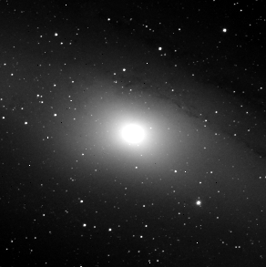

<p align="center"></p>

# Q-FIT AI — Quantum Framework for Intelligent Tracking

**Türkçe özet.** Q-FIT AI, NASA Space Apps Challenge (SPHEREx) projemizin yapay zekâ asistanıdır. Bu
klasör (`QFIT-AI/`) arka ucu, yapay zekâ katmanını, bilgi tabanını, kızılgerdan maskotunu ve React +
Three.js için hazır asistan bileşenini içerir; projenin 3B tasarım ve arayüz bölümleri ekibin diğer
klasörlerindedir. Asistan "Beni Vega'ya götür" gibi istekleri anlar, gökyüzü görünümünü oraya çevirir,
NASA/IPAC IRSA arşivinden gerçek SPHEREx gözlemlerini, görüntü önizlemelerini ve tayf bilgisini getirir;
Türkçe ve İngilizce yanıt verir. Kesin kuralı: veri uydurmaz, her sayının kaynağı vardır, bir aday asla
"keşif" diye sunulmaz. "Quantum" yalnızca proje adıdır; kuantum hesaplama yapılmaz.

**English.** Q-FIT AI is the assistant of a NASA Space Apps Challenge project that makes SPHEREx sky
images easy to explore. It turns natural-language requests ("Take me to Vega", "What SPHEREx data is
available for this region?") into real queries against public astronomy archives and returns a
structured JSON answer for the project's React + Three.js front end. Its face is a robin (kızılgerdan)
that sits in a corner of the sky view and pulls a chat panel open with its beak.

<p align="center"><br>
<sub>Andromeda Galaxy (M31): a PNG preview the backend made from a real SPHEREx spectral image
(<code>spherex_qr3:2026W32_1A_0420_1:D1</code>, detector band 1, 0.5° cutout from NASA/IPAC IRSA).
A display image, stretched for viewing: one band, one exposure, not a measurement.</sub></p>

## Quick start

```bash
cd QFIT-AI
python -m venv .venv && .venv/Scripts/activate      # macOS/Linux: source .venv/bin/activate
pip install -r requirements.txt
cp .env.example .env                                 # then put your OpenAI key in .env
python run.py                                        # API on http://127.0.0.1:8000, docs at /docs
```


| Folder | What |
|---|---|
| `app/` | The backend: FastAPI REST API, AI agent, data tools, knowledge base, candidate log |
| `research/` | Knowledge documents (TR/EN), source registry, example dataset, evaluation reports |
| `mascot/react/src/qfit/` | The robin mascot + chat panel as a React component (thinking/speaking animations, beak pull); copy into the app |
| `mascot/vanilla/` | The same mascot + chat panel as plain HTML/CSS/JS |
| `mascot/assets/` | Mascot art: original files, aligned frames, sprite sheets, icons, `mascot.json` |
| `docs/` | Architecture, API and front-end contracts, mascot spec, deployment, evaluation |
| `scripts/` | Dataset builder, evaluation runner, mascot asset builder, live check |
| `LICENSE` (repository root) | MIT |
| `tests/` | Unit tests (no network) and live tests (`--run-live`) |

## Mission

Reliable data access, nothing more at this stage:

- understand an astronomical request,
- resolve the object or coordinates,
- verify in the NASA/IPAC IRSA archive what SPHEREx actually observed there,
- return observation metadata, image products, spectral products and observation periods,
- tell the frontend what to do with them (`focus_map`, `display_observations`, ...).

Q-FIT never fills gaps with invented values. If the archive returns nothing, the answer is an explicit
no-data result with the likely reasons.

## Architecture

```
React + Three.js front end (team; uses mascot/react)
      │  REST / JSON
┌─────▼──────────────────────────────────────────────────────────────┐
│ app/api        FastAPI routes, one response envelope, error mapping │
│ app/ai         OpenAI provider · agent loop · tools · grounding     │
│ app/services   search · observations · retrieval · response builder │
│ app/astronomy  IRSA SIA2/TAP client · SPHEREx client · resolvers    │
└─────┬───────────────┬────────────────────┬─────────────────────────┘
   NASA/IPAC IRSA   SIMBAD / Sesame     JPL Horizons
```

The language model can only reach data through the tool registry, and the structured part of every
answer is built from tool results, never from model text. Details: `docs/ARCHITECTURE.md`.

## Technology stack

| Area | Packages |
|---|---|
| Backend | Python 3.11+, FastAPI, Uvicorn, Pydantic v2, pydantic-settings, python-dotenv |
| HTTP | HTTPX (async, time-outs, retries) |
| AI | OpenAI Responses API with function calling (default); Gemini and Ollama providers kept |
| Mascot component | React 18+, TypeScript (in `mascot/react/`); plain JS version in `mascot/vanilla/` |
| Astronomy | Astropy (FITS, WCS, coordinates), Astroquery (SIMBAD; brings PyVO), NumPy |
| Tests | Pytest, pytest-asyncio |

SciPy, Pandas and Requests from the original wish list are not installed: nothing in this stage
needs them.

## Installation

```bash
cd QFIT-AI
python -m venv .venv
# Windows PowerShell:  .venv\Scripts\Activate.ps1
# macOS / Linux:       source .venv/bin/activate
pip install -r requirements.txt
```

## Environment configuration

Copy `.env.example` to `.env` and fill in the key. `.env` is git-ignored. Every variable is
explained in `.env.example`; production values are in `docs/DEPLOYMENT.md`.

| Variable | Purpose | Default |
|---|---|---|
| `LLM_PROVIDER` | `openai`, `gemini` or `ollama` | `openai` |
| `OPENAI_API_KEY`, `OPENAI_MODEL` | OpenAI key (server only) and model. Only `/chat` needs them. | empty |
| `SPHEREX_BASE_URL` | IRSA base URL | `https://irsa.ipac.caltech.edu` |
| `HORIZONS_API_URL` | JPL Horizons API | `https://ssd.jpl.nasa.gov/api/horizons.api` |
| `CORS_ORIGINS` | Comma-separated frontend origins | `http://localhost:3000,http://localhost:5173` |
| `LOG_LEVEL`, `HOST`, `PORT` | Server settings | `INFO`, `127.0.0.1`, `8000` |
| `HTTP_TIMEOUT_SECONDS`, `HTTP_MAX_RETRIES`, `CACHE_TTL_SECONDS` | Outbound request policy | `45`, `2`, `600` |
| `MAX_REQUEST_BODY_BYTES`, `CHAT_RATE_LIMIT_PER_MINUTE` | Inbound limits | `65536`, `20` |
| `CHAT_DAILY_LIMIT`, `CHAT_TIMEOUT_SECONDS` | Site-wide model calls per UTC day; maximum length of one chat turn | `500`, `90` |
| `TRUST_PROXY_HEADERS` | Client IP from `X-Forwarded-For` (only behind a proxy) | `false` |
| `QFIT_TEAM_TOKEN` | When set, candidate writes need header `X-QFit-Token` | empty |
| `QFIT_DATA_DIR` | Candidate log folder | `data` |

## Choosing the language model

| `LLM_PROVIDER` | Needs | Notes |
|---|---|---|
| `openai` (default, used by the team) | `OPENAI_API_KEY` (platform.openai.com, billing enabled) and `OPENAI_MODEL` (`gpt-6-astra`) | Responses API with function calling. A ChatGPT subscription does not include API usage. |
| `gemini` | `GEMINI_API_KEY` | The free tier allowed only 20 requests per day for `gemini-3.8-flash` (2026-11-14); one chat question uses 1-4. |
| `ollama` | The Ollama app running, a model pulled with `ollama pull <model>`, `OLLAMA_MODEL=<model>` | No key, no quota, runs on the backend machine. Small local models choose tools and write Turkish less reliably: measure with `python scripts/evaluate.py agent --provider ollama --model <model> --limit 10`. |

With `AI_FALLBACK_ENABLED=true` (default), `/chat` never fails because of the model: if it is not
configured, out of quota or unreachable, the answer is the most relevant cited knowledge-base passage,
`data.fallback.active` is `true` and `message_source` is `system`. The structured endpoints never use
the model.

## Run

```bash
python run.py
```

Interactive API docs: http://127.0.0.1:8000/docs · OpenAPI: `/openapi.json`


## API endpoints

All paths are under `/api/v1`; `/health` and `/chat` are also served at the root for the web front end.
Every endpoint returns the same envelope (see `docs/API_CONTRACT.md`, and `docs/FRONTEND_CONTRACT.md`
for the React + Three.js integration and CORS).

| Method | Path | Purpose |
|---|---|---|
| POST | `/chat` | Natural-language assistant (OpenAI + tools; knowledge-base fallback) |
| POST | `/objects/search` | Search catalog objects by name |
| GET | `/objects/{object_id}` | Object information |
| POST | `/objects/by-coordinates` | Catalog objects near a position, optional type filter |
| POST | `/coordinates/resolve` | Name → coordinates |
| GET | `/observations` | SPHEREx observations by `ra`+`dec` or `object` |
| POST | `/observations/search` | Structured SPHEREx archive search |
| POST | `/observations/periods` | Observation periods for a target |
| GET | `/observations/{observation_id}` | Metadata of one observation |
| POST | `/images/search` | Image products with download, cutout and PNG preview URLs |
| GET | `/images/preview`, `/images/preview/info` | PNG preview of a spectral image cutout; its sky corners for Three.js |
| POST | `/spectrum/search` | Spectral products for a target |
| GET | `/spectrum/{observation_id}` | Spectral information of one observation |
| POST | `/knowledge/search` | Search the cited TR/EN knowledge base |
| GET | `/knowledge/sources` | The scientific source registry |
| POST, GET | `/candidates`, `/candidates/{id}` | Submit / list / read citizen-science candidates |
| POST | `/candidates/{id}/reviews`, `…/reviews/{review_id}/validation`, `…/confirmation` | Review, second-person validation, external reference |
| GET | `/candidates/{id}/audit` | Hash-chained event history |
| GET | `/health` | Health (`?deep=true` also probes the archives) |
| GET | `/capabilities` | Features, tools, data sources, limits |

## Example requests

```bash
curl -X POST http://127.0.0.1:8000/api/v1/chat -H "Content-Type: application/json" \
  -d '{"message": "Show me the Andromeda Galaxy."}'

curl -X POST http://127.0.0.1:8000/api/v1/coordinates/resolve -H "Content-Type: application/json" \
  -d '{"name": "Andromeda Galaxy"}'

curl "http://127.0.0.1:8000/api/v1/observations?ra=127.69444&dec=-39.1776&limit=5"

curl -X POST http://127.0.0.1:8000/api/v1/observations/periods -H "Content-Type: application/json" \
  -d '{"object_name": "M31"}'

curl -X POST http://127.0.0.1:8000/api/v1/images/search -H "Content-Type: application/json" \
  -d '{"ra": 127.69444, "dec": -39.1776, "cutout_size_deg": 0.1, "verify": true}'
```

## Example response

`GET /api/v1/observations?ra=127.69444&dec=-39.1776&release=qr3&limit=1`, abridged. The observation
record is a real IRSA row (queried 2026-11-14; the same query returned 14 files at a 0.01° radius).

```json
{
  "success": true,
  "assistant": "Q-FIT",
  "intent": "search_observations",
  "message": "The IRSA archive lists 14 SPHEREx spectral image file(s) from ...",
  "message_source": "system",
  "object": null,
  "data": {
    "spherex_available": true,
    "observations": [
      {
        "observation_id": "spherex_qr3:2026W21_1A_0491_2:D4",
        "obs_id": "2026W21_1A_0491_2",
        "collection": "spherex_qr3",
        "release": "QR3",
        "survey": "wide",
        "product_kind": "spectral_image",
        "detector": 4,
        "bandpass": "SPHEREx-D4",
        "t_min_mjd": 61181.214941,
        "t_min_utc": "2026-05-21T05:09:30Z",
        "exposure_s": 113.5826,
        "wavelength_min_um": 2.4027,
        "wavelength_max_um": 3.8473,
        "resolving_power": 34.9,
        "access_url": "https://irsa.ipac.caltech.edu/ibe/data/spherex/qr3/level2/2026W21_1A/l2b-v27-2026-268/4/level2_2026W21_1A_0491_2D4_spx_l2b-v27-2026-268.fits",
        "access_format": "image/fits",
        "est_size_kb": 58482,
        "metadata_source": "IRSA SIA2"
      }
    ],
    "spectral_products": [],
    "image_products": [],
    "search": { "status": "ok", "total": 14, "returned": 1, "has_more": true, "...": "..." }
  },
  "actions": [
    { "type": "focus_map", "payload": { "ra": 127.69444, "dec": -39.1776, "frame": "ICRS" } },
    { "type": "display_observations", "payload": { "total": 14, "returned": 1, "...": "..." } }
  ],
  "sources": [
    { "name": "NASA/IPAC Infrared Science Archive (IRSA) - SPHEREx", "url": "https://irsa.ipac.caltech.edu/Missions/spherex.html" }
  ],
  "error": null,
  "meta": { "request_id": "…", "timestamp": "…", "api_version": "v1", "tools_called": [], "ai_model": null }
}
```

## External data sources

| Source | Used for | Mechanism |
|---|---|---|
| NASA/IPAC IRSA | SPHEREx spectral images (DR1, QR3; wide and deep), DR1 All-Sky Cube | SIA 2.0, TAP/ADQL, IBE cutouts |
| SIMBAD (CDS) | Deep-sky names, coordinates, object types, cone search | `astroquery.simbad` |
| CDS Sesame | Fallback name resolver | Astropy name resolver |
| JPL Horizons | Positions of planets, comets, asteroids | Horizons REST API |

Full description: `docs/DATA_SOURCES.md`.

## Testing

```bash
pytest                                   # unit tests, no network, no key
pytest --run-live -rs                    # + live tests against IRSA, SIMBAD, Horizons
GEMINI_API_KEY=... pytest --run-live -rs # + live Gemini connectivity and tool selection
python scripts/live_check.py             # readable end-to-end check of the data layer
python scripts/build_dataset.py          # check + split the example dataset
python scripts/evaluate.py retrieval     # retrieval evaluation (no key needed)
python scripts/evaluate.py agent         # agent evaluation (needs GEMINI_API_KEY, uses quota)
```

AI layer documentation: `docs/AI_ARCHITECTURE.md`, `docs/AI_TRAINING_PIPELINE.md`,
`docs/SCIENTIFIC_SOURCES.md`, `docs/MODEL_EVALUATION.md`.

Test categories are kept apart on purpose:

- **Unit tests** use a mocked IRSA/Horizons transport, a stubbed SIMBAD and a scripted LLM.
- **Live tests** (`@pytest.mark.live`) call the real services. If a service cannot be reached the test
  is reported as `SKIPPED ... BLOCKED`, not as passed.
- **Credential tests** (`@pytest.mark.requires_credentials`) are skipped without `GEMINI_API_KEY`.

## Known limitations

- **Moving objects.** A Solar System body is resolved to its position at one epoch (JPL Horizons,
  geocentric). Q-FIT does not search the SPHEREx archive along an orbit; it refuses the fixed-position
  search and points to IRSA's Moving Object Search Tool.
- **Spectra.** A SPHEREx spectral image is one detector band with wavelength varying across the
  image. Q-FIT reports band coverage and the 102-channel All-Sky Cube tile, and can read single-pixel
  samples from cutouts. It does not do aperture photometry or build calibrated source spectra; IRSA's
  Spectrophotometry Tool does.
- **Releases.** Only what IRSA exposes through SIA2 is searchable: DR1 and QR3. QR2 is not. New
  exposures reach SIA2 about a day late.
- **Large result sets.** One archive query returns at most `max_archive_records` (5000) rows;
  pagination is applied to that set and `truncated_by_archive_limit` reports when the cap was hit.
- **All-Sky Cube tiles** are about 300 MB each. Q-FIT returns the reference and never downloads them.
- **State.** Cache and rate limiter are in-memory and per process.
- **Model.** The team uses OpenAI `gpt-6-astra` (name confirmed with the API on 2026-11-14). It rejects
  function tools in Chat Completions while reasoning is on, so the Responses API is used.
- See `docs/DATA_SOURCES.md` for what was verified live and how.

## Front-end integration

**Merging the project?** Give `docs/MASTER_PROMPT.md` to the AI that does the merge: it explains
the whole AI part, the contract, the mascot animations and the merge rules in one place.

The team's app is React + Three.js. Copy `mascot/react/src/qfit/` into it and render `<QFitAssistant>`;
pass the camera's RA/Dec as `context` and turn the camera on `focus_map` actions. Everything needed is
in `docs/FRONTEND_CONTRACT.md` (types, actions, FITS images, CORS) and `docs/MASCOT_AND_CHAT_UI.md`
(robin states, animations, panel behaviour). Deployment: `docs/DEPLOYMENT.md`.
