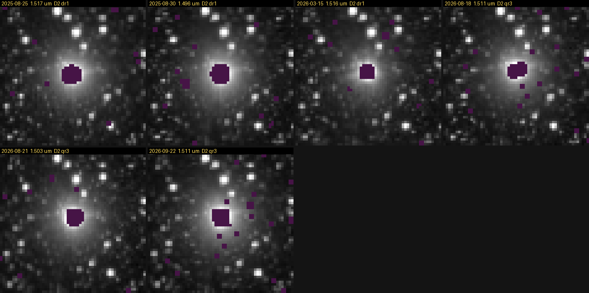

# Barnard's Star — target report

BlinkSpace pipeline 1.2.0 · sequence `tyswfqfx8t` · data: SPHEREx DR1, QR3 Level-2 spectral images (IRSA).

## Status

| Step | Result |
|---|---|
| Data available (≥ 2 matched-wavelength frames) | **yes** — 6 frames, 6 visits, 393 days |
| Source detected at the expected position | **yes** — 6/6 frames (6 saturated) |
| Change seen | **yes** — motion |
| Change scientifically confirmed | **no** — this tool never claims confirmation |

## 1. Identity and coordinate source

- SIMBAD main id: `NAME Barnard's star` · type BY* · spectral type M4V
- Aliases: 2MASS J17574849+0441405, GJ 699, Gaia DR2 4472832130942575872, Gaia DR3 4472832130942575872, HIP 87937, NAME Barnard Star
- Catalogue position (ICRS, epoch J2000.0): 17h57m48.50s +04d41m36.1s = (269.452077, 4.693365) · source 2020yCat.1350....0G
- Proper motion: (-801.551, 10362.394) mas/yr · source 2020yCat.1350....0G · parallax 546.9759 mas
- Largest known proper motion of any star (~10.4″/yr). With 6.15″ SPHEREx pixels it shifts about 1.7 pixels per year. Very bright (K≈4.5); core pixels may be saturated.

## 2. Query parameters

- Search centre (ICRS): (269.44627, 4.7682), epoch J2026.0 — 270.2″ from the J2000 position by proper motion only (no parallax, no observer position).
- Field 6.0′ · wavelength tolerance 0.5 × bandwidth · max frames 8 · requested wavelength: automatic (best time coverage)
- Discovery service: IRSA TAP (bundled inventory snapshot); cached index: True.
- ADQL: `SELECT p.obs_publisher_did, p.energy_bandpassname, p.time_bounds_lower, p.time_bounds_upper, p.time_exposure, p.provenance_version, p.poly, a.uri, a.contentchecksum, a.contentlength FROM spherex.plane p JOIN spherex.artifact a ON a.planeid = p.planeid WHERE 1 = CONTAINS(POINT('ICRS', 269.4462690, 4.7682040), p.poly)`

## 3. Bundled inventory snapshot

This inventory was supplied with the project; it is not represented as a fresh search. Current sequence discovery provenance appears in the JSON report under meta.archive.

- Archive rows 358 · unique observation×detector 357 · reprocessed copies dropped 0
- Time range (UTC): 2025-08-15T20:45:11Z → 2026-09-22T15:04:21Z · per detector {'1': 60, '2': 60, '3': 59, '4': 59, '5': 61, '6': 58}
- Collections {'spherex_dr1': 238, 'spherex_qr3': 119} · pipeline versions {'7.0.5': 357}
- Usable at this field size 339 (rejected near detector edge: 18) · wavelength groups with ≥ 2 visits: 40
- Full list: `reports/inventory/barnard_observations.csv`

## 4. Selected images

| # | Date (UTC) | Obs. id | Det. | Release / L2 tag | Pipeline | λ (µm) | Δλ/bw | invalid | suspect | comparable | raw SHA-256 |
|---|---|---|---|---|---|---|---|---|---|---|---|
| 1 | 2025-08-25T17:09:20Z | 2025W35_1A_0146_1 | 2 | dr1 / l2b-v27-2026-230 | 7.0.5 | 1.51677 | +0.14 | 0.026 | 0.007 | 0.974 | `bd04bc03db8e90f4…` |
| 2 | 2025-08-30T16:11:26Z | 2025W35_2A_0418_1 | 2 | dr1 / l2b-v27-2026-231 | 7.0.5 | 1.49617 | -0.42 | 0.033 | 0.012 | 0.636 | `443c9cffa9071fb3…` |
| 3 | 2026-03-15T00:51:21Z | 2026W11_2A_0501_3 | 2 | dr1 / l2b-v27-2026-234 | 7.0.5 | 1.51623 | +0.12 | 0.022 | 0.020 | 0.978 | `f261180dd0b96512…` |
| 4 | 2026-08-18T20:49:36Z | 2026W34_1A_0363_1 | 2 | qr3 / l2b-v27-2026-243 | 7.0.5 | 1.51115 | -0.02 | 0.034 | 0.006 | 0.966 | `bf248f899491dc47…` |
| 5 | 2026-08-21T18:56:00Z | 2026W34_2A_0264_1 | 2 | qr3 / l2b-v27-2026-243 | 7.0.5 | 1.50255 | -0.25 | 0.022 | 0.007 | 0.969 | `0332b27158e9dbe9…` |
| 6 | 2026-09-22T15:05:19Z | 2026W39_1A_0371_1 | 2 | qr3 / l2b-v27-2026-268 | 7.0.5 | 1.51119 | -0.01 | 0.036 | 0.046 | 0.964 | `e8c81fe24a84b85f…` |



*Preview tiles (magnified, common display scale; purple = no measurement). Previews are for inspection only, not for measurement.*

## 5. Time span and wavelength agreement

- 6 frames in 6 visits over 392.9 days (2025-08-25 → 2026-09-22).
- Reference wavelength 1.51174 µm, bandwidth 0.03711 µm (FWHM); all frames within 0.5 × bandwidth at the field centre (largest offset 0.42). The matched group in the archive has 6 frames in 6 visits.
- Pixels whose wavelength is outside the tolerance are masked per frame; area comparable in all frames: 57%.

## 6. Quality issues and rejected images

- Rejected after download: none
- Warnings: center_saturated
- Frame 1: flags within 2.5 px of field centre: TRANSIENT (15), OVERFLOW (5), SUR_ERROR (19), BLOOM (19); L2 QA Pass; PSF FWHM 7.46″ (EPSF).
- Frame 2: flags within 2.5 px of field centre: TRANSIENT (14), OVERFLOW (7), SUR_ERROR (18), BLOOM (19); L2 QA Pass; PSF FWHM 7.46″ (EPSF).
- Frame 3: flags within 2.5 px of field centre: TRANSIENT (14), OVERFLOW (5), SUR_ERROR (16), BLOOM (19); L2 QA Pass; PSF FWHM 7.46″ (EPSF).
- Frame 4: flags within 2.5 px of field centre: TRANSIENT (14), OVERFLOW (5), SUR_ERROR (13), BLOOM (19); L2 QA Pass; PSF FWHM 7.46″ (EPSF).
- Frame 5: flags within 2.5 px of field centre: TRANSIENT (14), OVERFLOW (7), SUR_ERROR (16), BLOOM (20); L2 QA Pass; PSF FWHM 7.46″ (EPSF).
- Frame 6: flags within 2.5 px of field centre: TRANSIENT (14), OVERFLOW (6), SUR_ERROR (16), BLOOM (19); L2 QA Pass; PSF FWHM 7.46″ (EPSF).

## 7. Alignment check

- 21 centroid measurements of Gaia DR3 stars (G ≤ 15.5) propagated to each frame epoch: median offset (-0.12″ E, -0.07″ N), rms 0.4″ = 0.07 pixel.
- Per frame: #1: n=4, rms 0.39″; #2: n=4, rms 0.48″; #3: n=2, rms 0.4″; #4: n=4, rms 0.33″; #5: n=4, rms 0.47″; #6: n=3, rms 0.22″

## 8. Detectability of the source

| # | Date | Method | Offset from prediction (E, N ″) | Aperture flux (mJy) | S/N | Note |
|---|---|---|---|---|---|---|
| 1 | 2025-08-25 | saturated_core_centroid | +3.09, -1.23 | no measurement | — | invalid_pixels_in_aperture |
| 2 | 2025-08-30 | saturated_core_centroid | +0.64, +0.42 | no measurement | — | invalid_pixels_in_aperture |
| 3 | 2026-03-15 | saturated_core_centroid | +3.24, +0.10 | no measurement | — | invalid_pixels_in_aperture |
| 4 | 2026-08-18 | saturated_core_centroid | -2.57, -0.37 | no measurement | — | invalid_pixels_in_aperture |
| 5 | 2026-08-21 | saturated_core_centroid | -4.52, +0.66 | no measurement | — | invalid_pixels_in_aperture |
| 6 | 2026-09-22 | saturated_core_centroid | -0.70, -1.10 | no measurement | — | invalid_pixels_in_aperture |

**Blending.** Catalogue sources within 20″ of the predicted positions (aperture radius 12.3″): Gaia DR3 4472835876142910336 (G=16.7, 17.3″ on 2025-08-25); Gaia DR3 4472835979222166400 (G=17.5, 19.7″ on 2026-09-22); AllWISE J175746.84+044624.0 (W1=17.099, W2=17.106, 11.5″, epoch ≈2010.5); AllWISE J175747.64+044546.5 (W1=14.786, W2=14.863, 17.2″, epoch ≈2010.5).

## 9. Possible change seen

- **Motion.** Linear fit to 6 positions over 1.076 yr: (-5.24, +10.43) ± 1.66 ″/yr (E, N); catalogue (-0.80, +10.36) ″/yr. Total shift 12.56″ = 2.04 pixels; significance 5.0σ; deviation from catalogue 1.9σ. Per-point error 1.84″ (assumed 0.3 px (saturated-core centroid)).
- **Brightness.** Insufficient reliable matched-wavelength measurements for a brightness comparison; consult the per-frame measurement reasons above.
- Wing-brightness proxy (unsaturated pixels 5–9 px from the centre, indicative only): max/min 1.83 over 6 usable frames. Not used for the status above.

## 10. Uncertainties and alternative explanations

- Where the method is saturated_core_centroid, the location describes the invalid saturated core rather than the stellar flux; pixel phase and bloom can shift that centroid.
- Observer parallax and spacecraft position are not modelled. The catalogue parallax is 0.5470 arcsec (0.089 SPHEREx pixels).
- The current motion fit uses per-point error 1.84 arcsec: assumed 0.3 px (saturated-core centroid).
- In this sequence, 6/6 frames meet the source-detection rule; 6 frames are flagged as saturated at the target.
- A valid comparison-star ensemble is unavailable for this measurement; no ensemble-verified brightness change is claimed.
- The scientific-confirmation status remains false. Neither catalogue predictions nor the display stack provide independent confirmation.

## 11. How to reproduce

```bash
cd backend
python -m tools.run_search --target barnard        # query, select, download, align, preview
python -m tools.measure_presets --only barnard     # detection, motion, brightness
python -m tools.target_report                  # regenerate these reports
```

Raw cutouts are stored unmodified under `data/raw/<sha256>.fits`; the SHA-256 of each is in the table above and in `barnard.json`. A later archive update produces a new sequence id; this report refers to the sequence above.
