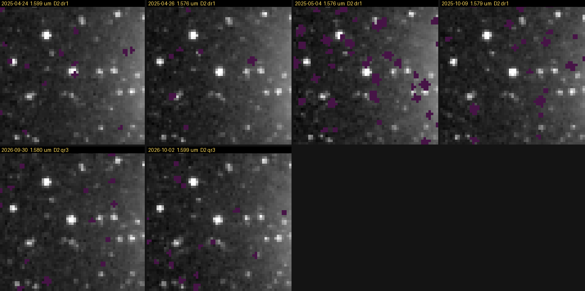

# Epsilon Indi B — target report

BlinkSpace pipeline 1.2.0 · sequence `vaszj8xtz2` · data: SPHEREx DR1, QR3 Level-2 spectral images (IRSA).

## Status

| Step | Result |
|---|---|
| Data available (≥ 2 matched-wavelength frames) | **yes** — 6 frames, 6 visits, 525 days |
| Source detected at the expected position | **yes** — 4/6 frames (0 saturated) |
| Change seen | **yes** — motion |
| Change scientifically confirmed | **no** — this tool never claims confirmation |

## 1. Identity and coordinate source

- SIMBAD main id: `* eps Ind B` · type BD* · spectral type T1V+T6V
- Aliases: * eps Ind B, 2MASS J22041052-5646577, GJ 845 B, GJ 845 C, Gaia DR2 6412596012146094848, Gaia DR3 6412596012146801152
- Catalogue position (ICRS, epoch J2000.0): 22h04m10.60s -56d46m58.2s = (331.044147, -56.782844) · source 2020yCat.1350....0G
- Proper motion: (3981.977, -2466.832) mas/yr · source 2020yCat.1350....0G · parallax 270.658 mas
- Brown-dwarf binary (Ba: T1, Bb: T6; separation ≈0.7″) about 400″ from Eps Indi A. SPHEREx cannot resolve the pair: expect a single blended source. This is not the primary star Eps Indi A.
- Not the primary: `* eps Ind` is 402.3″ away.

## 2. Query parameters

- Search centre (ICRS): (331.09664, -56.80066), epoch J2026.0 — 121.8″ from the J2000 position by proper motion only (no parallax, no observer position).
- Field 6.0′ · wavelength tolerance 0.5 × bandwidth · max frames 8 · requested wavelength: automatic (best time coverage)
- Discovery service: IRSA TAP (bundled inventory snapshot); cached index: True.
- ADQL: `SELECT p.obs_publisher_did, p.energy_bandpassname, p.time_bounds_lower, p.time_bounds_upper, p.time_exposure, p.provenance_version, p.poly, a.uri, a.contentchecksum, a.contentlength FROM spherex.plane p JOIN spherex.artifact a ON a.planeid = p.planeid WHERE 1 = CONTAINS(POINT('ICRS', 331.0966440, -56.8006600), p.poly)`

## 3. Bundled inventory snapshot

This inventory was supplied with the project; it is not represented as a fresh search. Current sequence discovery provenance appears in the JSON report under meta.archive.

- Archive rows 458 · unique observation×detector 456 · reprocessed copies dropped 0
- Time range (UTC): 2025-04-24T20:31:57Z → 2026-10-02T11:28:26Z · per detector {'1': 46, '2': 93, '3': 96, '4': 46, '5': 83, '6': 92}
- Collections {'spherex_dr1': 338, 'spherex_qr3': 118} · pipeline versions {'7.0.5': 456}
- Usable at this field size 401 (rejected near detector edge: 55) · wavelength groups with ≥ 2 visits: 40
- Full list: `reports/inventory/eps-indi-b_observations.csv`

## 4. Selected images

| # | Date (UTC) | Obs. id | Det. | Release / L2 tag | Pipeline | λ (µm) | Δλ/bw | invalid | suspect | comparable | raw SHA-256 |
|---|---|---|---|---|---|---|---|---|---|---|---|
| 1 | 2025-04-24T20:35:04Z | 2025W17_4B_0017_2 | 2 | dr1 / l2b-v27-2026-196 | 7.0.5 | 1.59932 | +0.46 | 0.015 | 0.010 | 0.574 | `fbb6e8e06aebec64…` |
| 2 | 2025-04-26T19:44:33Z | 2025W17_4B_0315_1 | 2 | dr1 / l2b-v27-2026-196 | 7.0.5 | 1.57576 | -0.15 | 0.011 | 0.055 | 0.989 | `444d55e7f660014c…` |
| 3 | 2025-05-04T16:52:51Z | 2025W18_2B_0489_1 | 2 | dr1 / l2b-v27-2026-197 | 7.0.5 | 1.57571 | -0.15 | 0.085 | 0.077 | 0.915 | `96c1ae7918cfae77…` |
| 4 | 2025-10-09T19:54:45Z | 2025W41_2B_0083_1 | 2 | dr1 / l2b-v27-2026-242 | 7.0.5 | 1.57939 | -0.06 | 0.038 | 0.060 | 0.962 | `f75fd280e770c0b7…` |
| 5 | 2026-09-30T07:23:10Z | 2026W40_1A_0518_1 | 2 | qr3 / l2b-v27-2026-276 | 7.0.5 | 1.57952 | -0.05 | 0.018 | 0.010 | 0.983 | `3e4333edb762556a…` |
| 6 | 2026-10-02T06:32:51Z | 2026W40_2A_0172_1 | 2 | qr3 / l2b-v27-2026-285 | 7.0.5 | 1.59887 | +0.45 | 0.020 | 0.007 | 0.592 | `810c84488b0f84fe…` |



*Preview tiles (magnified, common display scale; purple = no measurement). Previews are for inspection only, not for measurement.*

## 5. Time span and wavelength agreement

- 6 frames in 6 visits over 525.4 days (2025-04-24 → 2026-10-02).
- Reference wavelength 1.58153 µm, bandwidth 0.03839 µm (FWHM); all frames within 0.5 × bandwidth at the field centre (largest offset 0.46). The matched group in the archive has 10 frames in 8 visits.
- Pixels whose wavelength is outside the tolerance are masked per frame; area comparable in all frames: 15%.

## 6. Quality issues and rejected images

- Rejected after download: 2025W23_2B_0285_1 D2 (wavelength_mismatch_after_download); 2026W40_1A_0721_3 D2 (wavelength_mismatch_after_download)
- Warnings: partial_data
- Frame 1: flags within 2.5 px of field centre: NONFUNC (1); L2 QA Pass; PSF FWHM 7.46″ (EPSF).
- Frame 2: flags within 2.5 px of field centre: none; L2 QA Pass; PSF FWHM 7.46″ (EPSF).
- Frame 3: flags within 2.5 px of field centre: HALO (1); L2 QA Pass; PSF FWHM 7.46″ (EPSF).
- Frame 4: flags within 2.5 px of field centre: PERSIST (2); L2 QA Pass; PSF FWHM 7.46″ (EPSF).
- Frame 5: flags within 2.5 px of field centre: none; L2 QA Pass; PSF FWHM 7.46″ (EPSF).
- Frame 6: flags within 2.5 px of field centre: none; L2 QA Pass; PSF FWHM 7.46″ (EPSF).

## 7. Alignment check

- 11 centroid measurements of Gaia DR3 stars (G ≤ 15.5) propagated to each frame epoch: median offset (-0.09″ E, -0.22″ N), rms 0.46″ = 0.07 pixel.
- Per frame: #1: n=1, rms 0.49″; #2: n=1, rms 0.36″; #3: n=1, rms 0.57″; #4: n=3, rms 0.54″; #5: n=2, rms 0.24″; #6: n=3, rms 0.47″

## 8. Detectability of the source

| # | Date | Method | Offset from prediction (E, N ″) | Aperture flux (mJy) | S/N | Note |
|---|---|---|---|---|---|---|
| 1 | 2025-04-24 | invalid_pixels_at_target | — | no measurement | — | invalid_pixels_in_aperture |
| 2 | 2025-04-26 | flux_weighted_centroid | +0.07, -0.33 | 39.077 ± 0.207 | 188.6 |  |
| 3 | 2025-05-04 | not located | — | no measurement | — | invalid_pixels_in_aperture |
| 4 | 2025-10-09 | flux_weighted_centroid | -0.16, -0.81 | 41.128 ± 0.212 | 194.4 |  |
| 5 | 2026-09-30 | flux_weighted_centroid | +0.18, -1.33 | 40.174 ± 0.203 | 197.6 |  |
| 6 | 2026-10-02 | flux_weighted_centroid | -0.36, -0.96 | 39.004 ± 0.201 | 193.6 |  |

- Weighted mean of forced photometry at the predicted positions: 39.8239 ± 0.1029 mJy (S/N 387.0, 4 frames). This is a mean at a known position, not an independent detection.

**Blending.** Catalogue sources within 20″ of the predicted positions (aperture radius 12.3″): AllWISE J220422.36-564811.2 (W1=16.824, W2=16.563, 11.1″, epoch ≈2010.5); AllWISE J220424.47-564755.3 (W1=16.866, W2=17.114, 11.7″, epoch ≈2010.5); AllWISE J220423.27-564742.3 (W1=16.397, W2=16.074, 18.7″, epoch ≈2010.5).

## 9. Possible change seen

- **Motion.** Linear fit to 4 positions over 1.433 yr: (+3.91, -2.98) ± 0.49 ″/yr (E, N); catalogue (+3.98, -2.47) ″/yr. Total shift 7.05″ = 1.15 pixels; significance 7.0σ; deviation from catalogue 0.7σ. Per-point error 0.62″ (sequence alignment rms vs Gaia (per-axis, floor 0.1 px)).
- **Brightness.** 3 reliable points at 1.57936 µm (mJy; normalised by 3 comparison stars; systematic 4%; wavelength tolerance used 0.25): 2025-04-26: 39.1 ± 1.8, 2025-10-09: 41.4 ± 1.9, 2026-09-30: 40.2 ± 1.8. Max/min 1.06, difference 0.9σ.

## 10. Uncertainties and alternative explanations

- Ba and Bb are unresolved at SPHEREx's pixel scale. A measured location or flux refers to their combined image, not a resolved component.
- Observer parallax and spacecraft position are not modelled. The catalogue parallax is 0.2707 arcsec (0.044 SPHEREx pixels).
- The current motion fit uses per-point error 0.62 arcsec: sequence alignment rms vs Gaia (per-axis, floor 0.1 px).
- In this sequence, 4/6 frames meet the source-detection rule; 0 frames are flagged as saturated at the target.
- The current brightness analysis uses wavelength tolerance 0.25 bandwidth and a 4.5% systematic term. These values are computed for this sequence, not inherited from earlier reports.
- The scientific-confirmation status remains false. Neither catalogue predictions nor the display stack provide independent confirmation.

## 11. How to reproduce

```bash
cd backend
python -m tools.run_search --target eps-indi-b        # query, select, download, align, preview
python -m tools.measure_presets --only eps-indi-b     # detection, motion, brightness
python -m tools.target_report                  # regenerate these reports
```

Raw cutouts are stored unmodified under `data/raw/<sha256>.fits`; the SHA-256 of each is in the table above and in `eps-indi-b.json`. A later archive update produces a new sequence id; this report refers to the sequence above.
