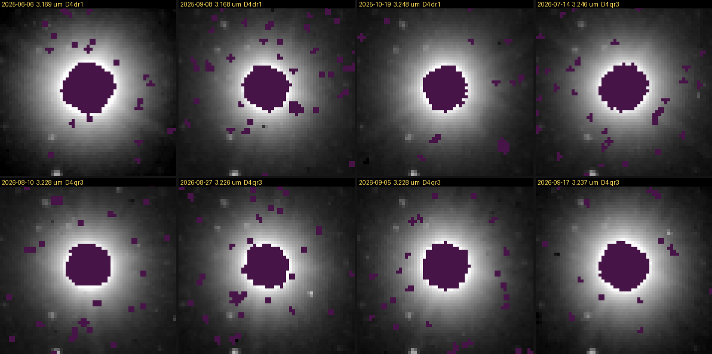

# R Draconis — target report

BlinkSpace pipeline 1.2.0 · sequence `hq75kubcj4` · data: SPHEREx DR1, QR3 Level-2 spectral images (IRSA).

## Status

| Step | Result |
|---|---|
| Data available (≥ 2 matched-wavelength frames) | **yes** — 8 frames, 8 visits, 468 days |
| Source detected at the expected position | **yes** — 8/8 frames (8 saturated) |
| Change seen | **no** |
| Change scientifically confirmed | **no** — this tool never claims confirmation |

## 1. Identity and coordinate source

- SIMBAD main id: `V* R Dra` · type Mi* · spectral type M4.5-6+e
- Aliases: 2MASS J16324023+6645180, Gaia DR2 1648328016352398848, Gaia DR3 1648328016354496384, HD 149880, HIP 81014, V* R Dra
- Catalogue position (ICRS, epoch J2000.0): 16h32m40.23s +66d45m17.9s = (248.167611, 66.754979) · source 2020yCat.1350....0G
- Proper motion: (-20.643, 6.149) mas/yr · source 2020yCat.1350....0G · parallax 1.2509 mas
- Mira-type long-period variable (period ≈245 d). About 9° from the north ecliptic pole inside the SPHEREx deep field: hundreds of repeat observations. Very bright in the near-infrared; core pixels are saturated.

## 2. Query parameters

- Search centre (ICRS): (248.16723, 66.75502), epoch J2026.0 — 0.6″ from the J2000 position by proper motion only (no parallax, no observer position).
- Field 6.0′ · wavelength tolerance 0.5 × bandwidth · max frames 8 · requested wavelength: automatic (best time coverage)
- Discovery service: IRSA TAP (bundled inventory snapshot); cached index: True.
- ADQL: `SELECT p.obs_publisher_did, p.energy_bandpassname, p.time_bounds_lower, p.time_bounds_upper, p.time_exposure, p.provenance_version, p.poly, a.uri, a.contentchecksum, a.contentlength FROM spherex.plane p JOIN spherex.artifact a ON a.planeid = p.planeid WHERE 1 = CONTAINS(POINT('ICRS', 248.1672330, 66.7550240), p.poly)`

## 3. Bundled inventory snapshot

This inventory was supplied with the project; it is not represented as a fresh search. Current sequence discovery provenance appears in the JSON report under meta.archive.

- Archive rows 2493 · unique observation×detector 2485 · reprocessed copies dropped 0
- Time range (UTC): 2025-04-24T21:06:38Z → 2026-09-27T06:59:18Z · per detector {'1': 579, '2': 89, '3': 573, '4': 582, '5': 89, '6': 573}
- Collections {'spherex_dr1_deep': 1224, 'spherex_dr1': 413, 'spherex_qr3': 126, 'spherex_qr3_deep': 722} · pipeline versions {'7.0.5': 2485}
- Usable at this field size 2298 (rejected near detector edge: 187) · wavelength groups with ≥ 2 visits: 40
- Full list: `reports/inventory/r-dra_observations.csv`

## 4. Selected images

| # | Date (UTC) | Obs. id | Det. | Release / L2 tag | Pipeline | λ (µm) | Δλ/bw | invalid | suspect | comparable | raw SHA-256 |
|---|---|---|---|---|---|---|---|---|---|---|---|
| 1 | 2025-06-06T11:23:21Z | 2025W23_2B_0206_1 | 4 | dr1 / l2b-v27-2026-201 | 7.0.5 | 3.16908 | -0.42 | 0.090 | 0.015 | 0.615 | `87d787050dcdb293…` |
| 2 | 2025-09-08T10:16:20Z | 2025W37_1A_0100_3 | 4 | dr1 / l2b-v27-2026-235 | 7.0.5 | 3.16835 | -0.43 | 0.098 | 0.009 | 0.582 | `2343e06ff24e9b33…` |
| 3 | 2025-10-19T01:00:32Z | 2025W42_2A_0526_3 | 4 | dr1 / l2b-v27-2026-243 | 7.0.5 | 3.24817 | +0.43 | 0.068 | 0.011 | 0.606 | `421f01e5c4244315…` |
| 4 | 2026-07-14T21:41:41Z | 2026W29_1A_0364_1 | 4 | qr3 / l2b-v27-2026-276 | 7.0.5 | 3.24598 | +0.40 | 0.092 | 0.011 | 0.666 | `16789410c46696eb…` |
| 5 | 2026-08-10T20:26:37Z | 2026W33_1A_0175_3 | 4 | qr3 / l2b-v27-2026-240 | 7.0.5 | 3.22787 | +0.21 | 0.084 | 0.019 | 0.916 | `57cdad049861c494…` |
| 6 | 2026-08-27T16:21:55Z | 2026W35_2A_0040_1 | 4 | qr3 / l2b-v27-2026-246 | 7.0.5 | 3.22626 | +0.19 | 0.092 | 0.034 | 0.908 | `3622976ae0e35b53…` |
| 7 | 2026-09-05T05:42:23Z | 2026W36_2A_0474_3 | 4 | qr3 / l2b-v27-2026-254 | 7.0.5 | 3.22823 | +0.21 | 0.086 | 0.015 | 0.906 | `29ec03484840f4b6…` |
| 8 | 2026-09-17T10:55:45Z | 2026W38_1A_0674_4 | 4 | qr3 / l2b-v27-2026-261 | 7.0.5 | 3.2374 | +0.31 | 0.076 | 0.021 | 0.827 | `96a940a7a46ebe85…` |



*Preview tiles (magnified, common display scale; purple = no measurement). Previews are for inspection only, not for measurement.*

## 5. Time span and wavelength agreement

- 8 frames in 8 visits over 468.0 days (2025-06-06 → 2026-09-17).
- Reference wavelength 3.2084 µm, bandwidth 0.09339 µm (FWHM); all frames within 0.5 × bandwidth at the field centre (largest offset 0.43). The matched group in the archive has 44 frames in 40 visits.
- Pixels whose wavelength is outside the tolerance are masked per frame; area comparable in all frames: 5%.

## 6. Quality issues and rejected images

- Rejected after download: none
- Warnings: center_saturated
- Frame 1: flags within 2.5 px of field centre: OVERFLOW (21), SUR_ERROR (21), NONFUNC (1), BLOOM (20); L2 QA Pass; PSF FWHM 8.67″ (EPSF).
- Frame 2: flags within 2.5 px of field centre: OVERFLOW (21), SUR_ERROR (19), BLOOM (21); L2 QA Pass; PSF FWHM 8.67″ (EPSF).
- Frame 3: flags within 2.5 px of field centre: OVERFLOW (21), SUR_ERROR (18), BLOOM (21); L2 QA Pass; PSF FWHM 8.67″ (EPSF).
- Frame 4: flags within 2.5 px of field centre: OVERFLOW (20), SUR_ERROR (20), BLOOM (20); L2 QA Pass; PSF FWHM 8.67″ (EPSF).
- Frame 5: flags within 2.5 px of field centre: OVERFLOW (19), SUR_ERROR (19), BLOOM (19); L2 QA Pass; PSF FWHM 8.67″ (EPSF).
- Frame 6: flags within 2.5 px of field centre: OVERFLOW (21), SUR_ERROR (21), BLOOM (21); L2 QA Pass; PSF FWHM 8.67″ (EPSF).
- Frame 7: flags within 2.5 px of field centre: OVERFLOW (18), SUR_ERROR (18), BLOOM (18); L2 QA Pass; PSF FWHM 8.67″ (EPSF).
- Frame 8: flags within 2.5 px of field centre: OVERFLOW (20), SUR_ERROR (20), BLOOM (20); L2 QA Pass; PSF FWHM 8.67″ (EPSF).

## 7. Alignment check

- 12 centroid measurements of Gaia DR3 stars (G ≤ 15.5) propagated to each frame epoch: median offset (-3.25″ E, 1.57″ N), rms 4.86″ = 0.79 pixel.
- Per frame: #1: n=1, rms 4.09″; #2: n=1, rms 6.04″; #3: n=1, rms 3.15″; #4: n=2, rms 4.4″; #5: n=2, rms 4.95″; #6: n=2, rms 5.28″; #7: n=1, rms 3.13″; #8: n=2, rms 5.77″

## 8. Detectability of the source

| # | Date | Method | Offset from prediction (E, N ″) | Aperture flux (mJy) | S/N | Note |
|---|---|---|---|---|---|---|
| 1 | 2025-06-06 | saturated_core_centroid | -0.51, -1.36 | no measurement | — | invalid_pixels_in_aperture |
| 2 | 2025-09-08 | saturated_core_centroid | +0.74, +0.14 | no measurement | — | invalid_pixels_in_aperture |
| 3 | 2025-10-19 | saturated_core_centroid | +0.53, -1.16 | no measurement | — | invalid_pixels_in_aperture |
| 4 | 2026-07-14 | saturated_core_centroid | -0.08, +0.31 | no measurement | — | invalid_pixels_in_aperture |
| 5 | 2026-08-10 | saturated_core_centroid | -0.61, +1.52 | no measurement | — | invalid_pixels_in_aperture |
| 6 | 2026-08-27 | saturated_core_centroid | +0.22, -0.11 | no measurement | — | invalid_pixels_in_aperture |
| 7 | 2026-09-05 | saturated_core_centroid | -0.50, +0.12 | no measurement | — | invalid_pixels_in_aperture |
| 8 | 2026-09-17 | saturated_core_centroid | +0.01, -0.59 | no measurement | — | invalid_pixels_in_aperture |

**Blending.** Catalogue sources within 20″ of the predicted positions (aperture radius 12.3″): AllWISE J163240.19+664517.9 (W1=0.393, W2=0.129, 0.4″, epoch ≈2010.5).

## 9. Possible change seen

- **Motion.** Linear fit to 8 positions over 1.281 yr: (-0.32, +1.00) ± 1.32 ″/yr (E, N); catalogue (-0.02, +0.01) ″/yr. Total shift 1.34″ = 0.22 pixels; significance 0.6σ; deviation from catalogue 0.6σ. Per-point error 1.84″ (assumed 0.3 px (saturated-core centroid)).
- **Brightness.** Insufficient reliable matched-wavelength measurements for a brightness comparison; consult the per-frame measurement reasons above.
- Wing-brightness proxy (unsaturated pixels 5–9 px from the centre, indicative only): max/min 1.2 over 6 usable frames. Not used for the status above.

## 10. Uncertainties and alternative explanations

- Saturated or invalid core pixels have no flux measurement. A wing-brightness proxy, if available, is only indicative and is not used to establish variability.
- Bloom, halo, persistence and scattered light can affect centroids and background estimates; the actual per-frame quality flags above identify which effects were recorded.
- Observer parallax and spacecraft position are not modelled. The catalogue parallax is 0.0013 arcsec (0.000 SPHEREx pixels).
- The current motion fit uses per-point error 1.84 arcsec: assumed 0.3 px (saturated-core centroid).
- In this sequence, 8/8 frames meet the source-detection rule; 8 frames are flagged as saturated at the target.
- A valid comparison-star ensemble is unavailable for this measurement; no ensemble-verified brightness change is claimed.
- The scientific-confirmation status remains false. Neither catalogue predictions nor the display stack provide independent confirmation.

## 11. How to reproduce

```bash
cd backend
python -m tools.run_search --target r-dra        # query, select, download, align, preview
python -m tools.measure_presets --only r-dra     # detection, motion, brightness
python -m tools.target_report                  # regenerate these reports
```

Raw cutouts are stored unmodified under `data/raw/<sha256>.fits`; the SHA-256 of each is in the table above and in `r-dra.json`. A later archive update produces a new sequence id; this report refers to the sequence above.
