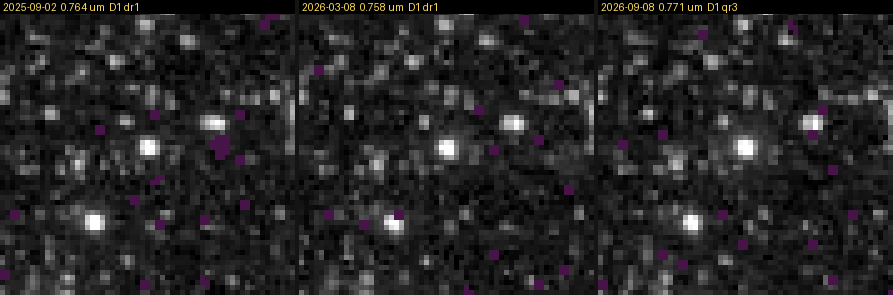

# RW Aurigae — target report

BlinkSpace pipeline 1.2.0 · sequence `nhvk2kebw6` · data: SPHEREx DR1, QR3 Level-2 spectral images (IRSA).

## Status

| Step | Result |
|---|---|
| Data available (≥ 2 matched-wavelength frames) | **yes** — 3 frames, 3 visits, 371 days |
| Source detected at the expected position | **yes** — 3/3 frames (0 saturated) |
| Change seen | **yes** — brightness |
| Change scientifically confirmed | **no** — this tool never claims confirmation |

## 1. Identity and coordinate source

- SIMBAD main id: `V* RW Aur` · type TT* · spectral type K1/5e+K5e
- Aliases: 2MASS J05074953+3024050, HD 240764, HIP 23873, V* RW Aur, WISE J050749.55+302404.9, WISEA J050749.54+302404.7
- Catalogue position (ICRS, epoch J2000.0): 05h07m49.57s +30d24m05.2s = (76.956526, 30.401438) · source 2007A&A...474..653V
- Proper motion: (7.23, -20.33) mas/yr · source 2007A&A...474..653V · parallax 15.42 mas
- Young (T Tauri) variable; components A and B are ≈1.4″ apart and appear as one source to SPHEREx. Known for irregular deep dimming events.

## 2. Query parameters

- Search centre (ICRS): (76.95659, 30.40129), epoch J2026.0 — 0.6″ from the J2000 position by proper motion only (no parallax, no observer position).
- Field 6.0′ · wavelength tolerance 0.5 × bandwidth · max frames 8 · requested wavelength: 0.765
- Discovery service: IRSA TAP (bundled inventory snapshot); cached index: True.
- ADQL: `SELECT p.obs_publisher_did, p.energy_bandpassname, p.time_bounds_lower, p.time_bounds_upper, p.time_exposure, p.provenance_version, p.poly, a.uri, a.contentchecksum, a.contentlength FROM spherex.plane p JOIN spherex.artifact a ON a.planeid = p.planeid WHERE 1 = CONTAINS(POINT('ICRS', 76.9565870, 30.4012910), p.poly)`
- Preset wavelength rationale from the prior inventory: The star carries saturation/non-linearity flags longward of 0.85 µm (the automatically chosen 2.16 µm group has a saturated core). In the 0.765 µm group all three visits are flag-free and usable for quantitative measurement.

## 3. Bundled inventory snapshot

This inventory was supplied with the project; it is not represented as a fresh search. Current sequence discovery provenance appears in the JSON report under meta.archive.

- Archive rows 335 · unique observation×detector 330 · reprocessed copies dropped 0
- Time range (UTC): 2025-09-01T10:04:18Z → 2026-09-16T21:30:06Z · per detector {'1': 56, '2': 55, '3': 56, '4': 56, '5': 56, '6': 51}
- Collections {'spherex_dr1': 223, 'spherex_qr3': 107} · pipeline versions {'7.0.5': 330}
- Usable at this field size 307 (rejected near detector edge: 23) · wavelength groups with ≥ 2 visits: 40
- Full list: `reports/inventory/rw-aur_observations.csv`

## 4. Selected images

| # | Date (UTC) | Obs. id | Det. | Release / L2 tag | Pipeline | λ (µm) | Δλ/bw | invalid | suspect | comparable | raw SHA-256 |
|---|---|---|---|---|---|---|---|---|---|---|---|
| 1 | 2025-09-02T00:46:30Z | 2025W36_1A_0233_3 | 1 | dr1 / l2b-v27-2026-232 | 7.0.5 | 0.76447 | -0.03 | 0.023 | 0.040 | 0.977 | `05a906b170cd81f9…` |
| 2 | 2026-03-08T16:15:59Z | 2026W10_2B_0591_4 | 1 | dr1 / l2b-v27-2026-231 | 7.0.5 | 0.75832 | -0.37 | 0.016 | 0.027 | 0.757 | `71af4a9171c330d6…` |
| 3 | 2026-09-08T06:39:20Z | 2026W37_1A_0234_3 | 1 | qr3 / l2b-v27-2026-255 | 7.0.5 | 0.77119 | +0.34 | 0.018 | 0.034 | 0.811 | `a3fb18e6f4e7a446…` |



*Preview tiles (magnified, common display scale; purple = no measurement). Previews are for inspection only, not for measurement.*

## 5. Time span and wavelength agreement

- 3 frames in 3 visits over 371.2 days (2025-09-02 → 2026-09-08).
- Reference wavelength 0.765 µm, bandwidth 0.0181 µm (FWHM); all frames within 0.5 × bandwidth at the field centre (largest offset 0.37). The matched group in the archive has 3 frames in 3 visits.
- Pixels whose wavelength is outside the tolerance are masked per frame; area comparable in all frames: 73%.

## 6. Quality issues and rejected images

- Rejected after download: none
- Warnings: none
- Frame 1: flags within 2.5 px of field centre: none; L2 QA Pass; PSF FWHM 7.53″ (EPSF).
- Frame 2: flags within 2.5 px of field centre: none; L2 QA Pass; PSF FWHM 7.53″ (EPSF).
- Frame 3: flags within 2.5 px of field centre: none; L2 QA Pass; PSF FWHM 7.53″ (EPSF).

## 7. Alignment check

- 8 centroid measurements of Gaia DR3 stars (G ≤ 15.5) propagated to each frame epoch: median offset (-0.16″ E, 0.04″ N), rms 0.49″ = 0.08 pixel.
- Per frame: #1: n=3, rms 0.14″; #2: n=2, rms 0.38″; #3: n=3, rms 0.73″

## 8. Detectability of the source

| # | Date | Method | Offset from prediction (E, N ″) | Aperture flux (mJy) | S/N | Note |
|---|---|---|---|---|---|---|
| 1 | 2025-09-02 | flux_weighted_centroid | -1.16, -0.37 | 74.075 ± 0.299 | 247.5 |  |
| 2 | 2026-03-08 | flux_weighted_centroid | -1.12, -0.85 | 124.510 ± 0.387 | 321.6 |  |
| 3 | 2026-09-08 | flux_weighted_centroid | -0.56, -0.37 | 191.644 ± 0.479 | 400.0 |  |

- Weighted mean of forced photometry at the predicted positions: 112.3207 ± 0.2123 mJy (S/N 529.1, 3 frames). This is a mean at a known position, not an independent detection.

**Blending.** Catalogue sources within 20″ of the predicted positions (aperture radius 12.3″): AllWISE J050749.54+302404.7 (W1=6.246, W2=5.228, 0.4″, epoch ≈2010.5).

## 9. Possible change seen

- **Motion.** Linear fit to 3 positions over 1.016 yr: (+0.60, -0.03) ± 0.86 ″/yr (E, N); catalogue (+0.01, -0.02) ″/yr. Total shift 0.61″ = 0.1 pixels; significance 0.5σ; deviation from catalogue 0.5σ. Per-point error 0.62″ (sequence alignment rms vs Gaia (per-axis, floor 0.1 px)).
- **Brightness.** 3 reliable points at 0.76447 µm (mJy; normalised by 5 comparison stars; systematic 10%; wavelength tolerance used 0.5): 2025-09-02: 74.1 ± 7.6, 2026-03-08: 124.4 ± 12.8, 2026-09-08: 191.6 ± 19.7. Max/min 2.587, difference 5.6σ.

## 10. Uncertainties and alternative explanations

- A and B are unresolved at SPHEREx's pixel scale; any supported change refers to their combined light.
- Aperture losses can differ with PSF and wavelength. Comparison-star normalisation and the explicitly reported systematic error only partly control these effects; no extinction mechanism is inferred from this report.
- Observer parallax and spacecraft position are not modelled. The catalogue parallax is 0.0154 arcsec (0.003 SPHEREx pixels).
- The current motion fit uses per-point error 0.62 arcsec: sequence alignment rms vs Gaia (per-axis, floor 0.1 px).
- In this sequence, 3/3 frames meet the source-detection rule; 0 frames are flagged as saturated at the target.
- The current brightness analysis uses wavelength tolerance 0.5 bandwidth and a 10.3% systematic term. These values are computed for this sequence, not inherited from earlier reports.
- The scientific-confirmation status remains false. Neither catalogue predictions nor the display stack provide independent confirmation.

## 11. How to reproduce

```bash
cd backend
python -m tools.run_search --target rw-aur        # query, select, download, align, preview
python -m tools.measure_presets --only rw-aur     # detection, motion, brightness
python -m tools.target_report                  # regenerate these reports
```

Raw cutouts are stored unmodified under `data/raw/<sha256>.fits`; the SHA-256 of each is in the table above and in `rw-aur.json`. A later archive update produces a new sequence id; this report refers to the sequence above.
