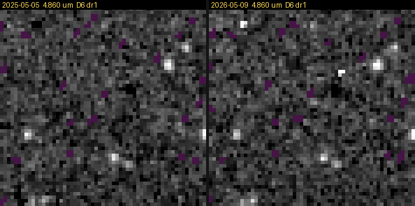

# WISE 0855−0714 — target report

BlinkSpace pipeline 1.2.0 · sequence `453tr9wzhc` · data: SPHEREx DR1 Level-2 spectral images (IRSA).

## Status

| Step | Result |
|---|---|
| Data available (≥ 2 matched-wavelength frames) | **yes** — 2 frames, 2 visits, 368 days |
| Source detected at the expected position | **no** — 0/2 frames (0 saturated) |
| Change seen | **no** |
| Change scientifically confirmed | **no** — this tool never claims confirmation |

## 1. Identity and coordinate source

- SIMBAD main id: `WISEA J085510.74-071442.5` · type BD* · spectral type Y2
- Aliases: WISE J085510.83-071442.5, WISEA J085510.74-071442.5
- Catalogue position (ICRS, epoch J2000.0): 08h55m16.54s -07d14m49.4s = (133.818908, -7.247048) · source 2021ApJS..253....7K
- Proper motion: (-8123.7, 673.2) mas/yr · source 2021ApJS..253....7K · parallax 439.0 mas
- Coldest known brown dwarf (Y type), proper motion ~8.1″/yr. Visible only near 4.5–5 µm and very faint (W2≈13.9); close to the single-exposure SPHEREx detection limit. The commonly quoted published coordinate is from the WISE epoch (~2010); by 2026 the source is ~2′ further west.
- Reference (WISE-epoch) coordinate 08h55m10.831s -7d14m42.53s is 85.2″ from the J2000 position (≈ WISE epoch) and 126.7″ from the J2026.0 search centre.

## 2. Query parameters

- Search centre (ICRS): (133.75976, -7.24219), epoch J2026.0 — 211.9″ from the J2000 position by proper motion only (no parallax, no observer position).
- Field 6.0′ · wavelength tolerance 0.5 × bandwidth · max frames 8 · requested wavelength: 4.86
- Discovery service: IRSA TAP (bundled inventory snapshot); cached index: True.
- ADQL: `SELECT p.obs_publisher_did, p.energy_bandpassname, p.time_bounds_lower, p.time_bounds_upper, p.time_exposure, p.provenance_version, p.poly, a.uri, a.contentchecksum, a.contentlength FROM spherex.plane p JOIN spherex.artifact a ON a.planeid = p.planeid WHERE 1 = CONTAINS(POINT('ICRS', 133.7597650, -7.2421860), p.poly)`
- Preset wavelength rationale from the prior inventory: The Y dwarf is only bright near 4.5–5 µm. In the archive inventory the 4.86 µm group has the longest baseline among suitable groups (3 visits, ~368 days); the automatic choice (2.34 µm) lands where the source is invisible.

## 3. Bundled inventory snapshot

This inventory was supplied with the project; it is not represented as a fresh search. Current sequence discovery provenance appears in the JSON report under meta.archive.

- Archive rows 258 · unique observation×detector 255 · reprocessed copies dropped 0
- Time range (UTC): 2025-05-05T16:48:02Z → 2026-05-14T06:53:36Z · per detector {'1': 36, '2': 47, '3': 45, '4': 36, '5': 48, '6': 43}
- Collections {'spherex_dr1': 255} · pipeline versions {'7.0.5': 255}
- Usable at this field size 249 (rejected near detector edge: 6) · wavelength groups with ≥ 2 visits: 40
- Full list: `reports/inventory/wise-0855_observations.csv`

## 4. Selected images

| # | Date (UTC) | Obs. id | Det. | Release / L2 tag | Pipeline | λ (µm) | Δλ/bw | invalid | suspect | comparable | raw SHA-256 |
|---|---|---|---|---|---|---|---|---|---|---|---|
| 1 | 2025-05-05T20:02:33Z | 2025W19_1B_0138_1 | 6 | dr1 / l2b-v27-2026-197 | 7.0.5 | 4.85985 | -0.00 | 0.026 | 0.019 | 0.974 | `beffad39f3f84a8b…` |
| 2 | 2026-05-09T04:40:38Z | 2026W19_2A_0651_1 | 6 | dr1 / l2b-v27-2026-245 | 7.0.5 | 4.85971 | -0.01 | 0.027 | 0.019 | 0.973 | `27203bf4678d4c38…` |



*Preview tiles (magnified, common display scale; purple = no measurement). Previews are for inspection only, not for measurement.*

## 5. Time span and wavelength agreement

- 2 frames in 2 visits over 368.4 days (2025-05-05 → 2026-05-09).
- Reference wavelength 4.86 µm, bandwidth 0.03791 µm (FWHM); all frames within 0.5 × bandwidth at the field centre (largest offset 0.01). The matched group in the archive has 3 frames in 3 visits.
- Pixels whose wavelength is outside the tolerance are masked per frame; area comparable in all frames: 96%.

## 6. Quality issues and rejected images

- Rejected after download: 2025W46_2A_0226_1 D6 (wavelength_mismatch_after_download)
- Warnings: partial_data
- Frame 1: flags within 2.5 px of field centre: none; L2 QA Pass; PSF FWHM 9.04″ (EPSF).
- Frame 2: flags within 2.5 px of field centre: none; L2 QA Pass; PSF FWHM 9.04″ (EPSF).

## 7. Alignment check

- 10 centroid measurements of Gaia DR3 stars (G ≤ 15.5) propagated to each frame epoch: median offset (0.01″ E, 0.49″ N), rms 1.28″ = 0.21 pixel.
- Per frame: #1: n=5, rms 1.05″; #2: n=5, rms 1.48″

## 8. Detectability of the source

| # | Date | Method | Offset from prediction (E, N ″) | Aperture flux (mJy) | S/N | Note |
|---|---|---|---|---|---|---|
| 1 | 2025-05-05 | not located | — | 0.413 ± 0.207 | 2.0 |  |
| 2 | 2026-05-09 | not located | — | 0.795 ± 0.219 | 3.6 |  |

- Weighted mean of forced photometry at the predicted positions: 0.5928 ± 0.1506 mJy (S/N 3.9, 2 frames). This is a mean at a known position, not an independent detection.

**Blending.** Catalogue sources within 20″ of the predicted positions (aperture radius 12.3″): Gaia DR3 5756956644387831296 (G=16.3, 4.5″ on 2026-05-09); AllWISE J085501.95-071428.1 (W1=14.983, W2=15.051, 4.6″, epoch ≈2010.5).

## 9. Possible change seen

- **Motion.** Not measurable (fewer than two located detections more than 30 days apart).
- **Brightness.** 2 reliable points at 4.85979 µm (mJy; no comparison-star check; systematic 0%; wavelength tolerance used 0.25): 2025-05-05: 0.4 ± 0.2, 2026-05-09: 0.8 ± 0.2. Max/min 1.924, difference 1.3σ.

## 10. Uncertainties and alternative explanations

- Flux at a predicted position can include unrelated background sources. The current catalogue blending check and per-frame S/N, when available, must be inspected before attributing the flux to WISE 0855.
- A co-moving display stack is available at the sequence track_stack endpoint. It aligns catalogue predictions but does not automatically remove blending or constitute a detection; quantitative values remain native-pixel forced photometry.
- Observer parallax and spacecraft position are not modelled. The catalogue parallax is 0.4390 arcsec (0.071 SPHEREx pixels).
- In this sequence, 0/2 frames meet the source-detection rule; 0 frames are flagged as saturated at the target.
- The current brightness analysis uses wavelength tolerance 0.25 bandwidth and a 0.0% systematic term. These values are computed for this sequence, not inherited from earlier reports.
- A valid comparison-star ensemble is unavailable for this measurement; no ensemble-verified brightness change is claimed.
- The scientific-confirmation status remains false. Neither catalogue predictions nor the display stack provide independent confirmation.

## 11. How to reproduce

```bash
cd backend
python -m tools.run_search --target wise-0855        # query, select, download, align, preview
python -m tools.measure_presets --only wise-0855     # detection, motion, brightness
python -m tools.target_report                  # regenerate these reports
```

Raw cutouts are stored unmodified under `data/raw/<sha256>.fits`; the SHA-256 of each is in the table above and in `wise-0855.json`. A later archive update produces a new sequence id; this report refers to the sequence above.
